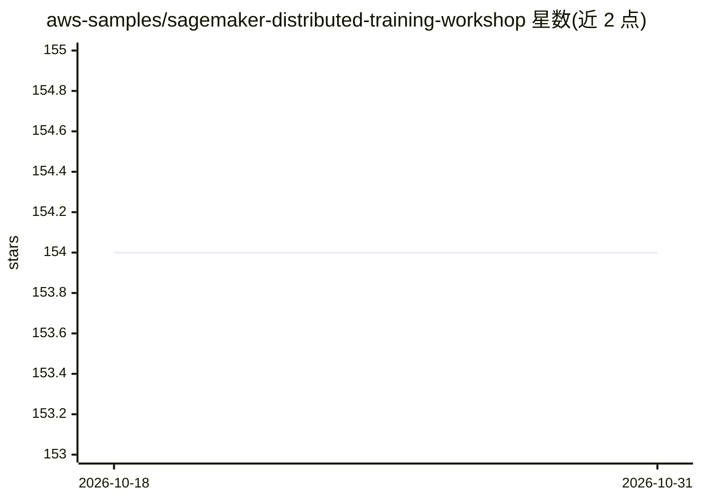

# aws-samples/sagemaker-distributed-training-workshop

⭐ 154 · Jupyter Notebook · Apache-2.0 · 推送 2026-06-16 · [GitHub](https://github.com/aws-samples/sagemaker-distributed-training-workshop) · 组织维护

**SageMaker 分布式训练与托管的动手实验教程**

AWS 官方 samples 组织发布的动手研讨会材料，包含数据并行与模型并行两个实验，介绍如何在 Amazon SageMaker Training 上使用高性能分布式训练库。内容自包含于 notebook 与目录文件，需 AWS 账号、SageMaker Studio 域及 ml.g4dn.12xlarge 实例配额提升。另附数据准备、Training Compiler、超参调优（Syne Tune）、DeepSpeed 托管 GPT-J 等延伸链接及论文与案例（如 175B 参数、140 个 p4d 节点训练）。

## 筛选速览

| 维度 | 判定 | 备注 |
|---|---|---|
| AI 角色 | `ai-knowledge` | 知识聚合/清单类 |
| 许可风险 | `permissive` | Apache-2.0 |
| 部署形态 | `library` | 以包/库形式分发 |
| 模型依赖 | — | README 未给出锁定关系 |
| 硬件要求 | — | 无带数字的原话,不猜 |
| 安装摩擦 | `low` | 无编译、无系统依赖或容器化 |
| 成熟度 | — | 结构信号不足 |

## 能力要点

- 数据并行与模型并行两个 hands-on 实验
- 覆盖 SageMaker Training Compiler、超参调优、DeepSpeed 托管等延伸主题
- 附 SageMaker Data Parallel（Herring）等论文与 Amazon Search 7.3x 加速案例

## 适用场景

- 学习在 SageMaker 上做数据并行与模型并行训练
- 了解大规模模型（如 GPT-3 量级）在 AWS 上的训练实践
- 查找分布式训练数据准备与托管的延伸资料

## 场景标签

`教程课程` `模型训练` · 领域:学习与行业

## 证据(README 行号)

> L1: # Distributed Training Workshop on Amazon SageMaker
> L5: Today you'll walk through two hands-on labs. The first one focuses on ***data parallelism***, and the second one is 

## 星数曲线

2026-10-18 154 → 2026-10-31 154（+0）

---
*卡片 v1 · prompt 1.4 · 生成 2026-10-22 · 置信度 mid · 依据 README sha `c367c404e627` · [字段定义](../../DATASET.md)*
