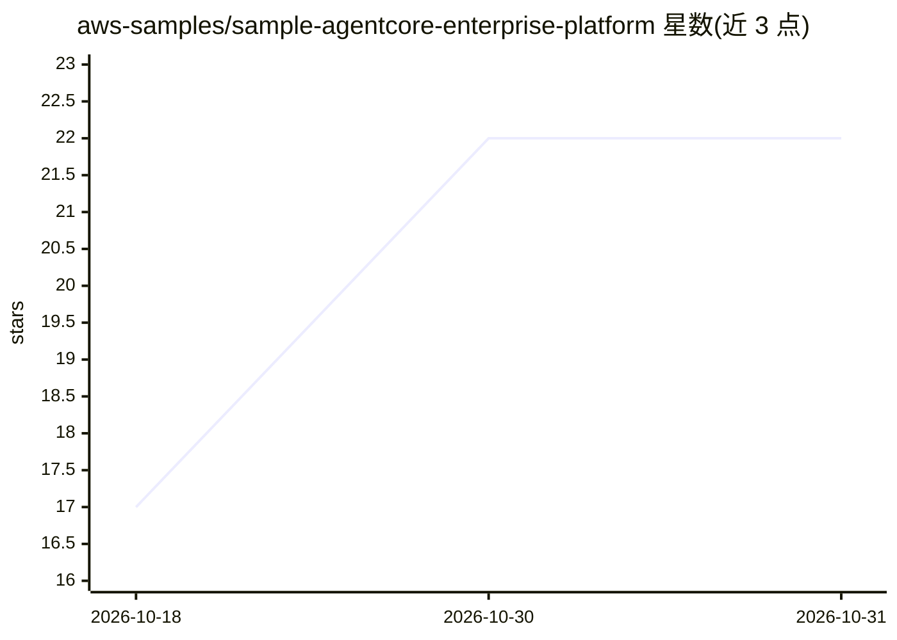

# aws-samples/sample-agentcore-enterprise-platform

⭐ 22 · Python · Apache-2.0 · 推送 2026-10-20 · [GitHub](https://github.com/aws-samples/sample-agentcore-enterprise-platform) · 组织维护

**面向企业团队的 Amazon Bedrock AgentCore 平台部署加速器**

基于 AWS CDK/Terraform 的开源加速器，用于在 Amazon Bedrock AgentCore 上搭建生产级 AI agent 平台，涵盖 Runtime、Gateway、Identity、Memory 与可观测性组件。通过 Design→Build→Verify 三阶段脚本驱动：以 platform.yaml 声明式配置，按 7 种预设 profile（greenfield/migration/production 等）部署 CloudFormation 栈，含 VPC 隔离、KMS、Cedar 策略、Bedrock Guardrails 等安全控制。支持 Strands Agents、LangGraph、Claude Agent SDK 框架。当前 v0.1.0，明确声明需按客户安全合规要求定制并完成 Production Readiness Plan 后方可视为生产就绪。

## 筛选速览

| 维度 | 判定 | 备注 |
|---|---|---|
| AI 角色 | `ai-ecosystem` | LLM/agent 周边工具 |
| 许可风险 | `permissive` | Apache-2.0 |
| 部署形态 | `library` | 以包/库形式分发 |
| 模型依赖 | locked-api |  |
| 硬件要求 | — | 无带数字的原话,不猜 |
| 安装摩擦 | `low` | 无编译、无系统依赖或容器化 |
| 成熟度 | `idea` | |

## 能力要点

- Design→Build→Verify 三命令工作流，deploy.sh doctor 预检本地工具与账户配置
- 7 种部署 profile（greenfield/migration/multi-agent/platform-team/security-focused/production）
- 可选 VPC 隔离、KMS 加密、CloudTrail、Cedar 策略、Bedrock Guardrails 等安全控制
- 本地 Dashboard 提供部署状态、X-Ray 服务地图与 Playground 受控测试

## 适用场景

- 企业在 AWS 上搭建带治理与安全基线的多 agent 平台
- 将既有容器迁移为 AgentCore Runtime 并接入网关
- 平台团队为组织建立共享的 agent 基础设施与可观测性

## 场景标签

`多智能体` `LLM 可观测性` · 领域:Agent 开发

## 证据(README 行号)

> L21: - **An AI platform for production agents:** AgentCore Runtime, Gateway, Identity, Memory, and observability.
> L22: - **Your choice of agent framework:** use Strands Agents, LangGraph, Claude Agent SDK, without rebuilding the infra
> L3: Deploy a secure, governed foundation for production AI agents on Amazon Bedrock AgentCore. This **open-source, modul

## 星数曲线

2026-10-18 17 → 2026-10-31 22（+5）

---
*卡片 v1 · prompt 1.4 · 生成 2026-10-29 · 置信度 high · 依据 README sha `6f4ac3ada9d0` · [字段定义](../../DATASET.md)*
