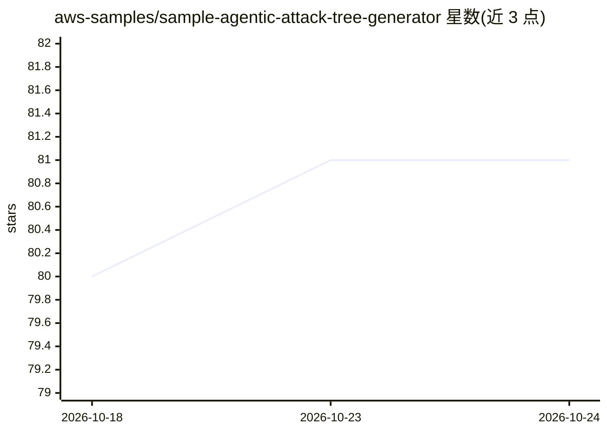

# aws-samples/sample-agentic-attack-tree-generator

⭐ 81 · TypeScript · MIT-0 · 推送 2026-08-01 · [GitHub](https://github.com/aws-samples/sample-agentic-attack-tree-generator) · [官网](http://aws-samples.github.io/sample-agentic-attack-tree-generator/) · 组织维护

**基于多 Agent 的威胁建模平台：从代码库自动生成攻击树**

ThreatForest 是构建在 Strands agent 框架之上的威胁建模平台：指向一个代码仓库后，由扫描器、威胁识别、攻击树生成、TTP 映射与缓解建议五个 agent 依序执行，并利用 ATTACK-BERT 语义嵌入将攻击步骤映射到 MITRE ATT&CK 技术，最终在交互式仪表盘中可视化展示。面向安全团队、架构师与 DevSecOps 工程师。需将项目上下文发送至所配置的 LLM 提供商；README 推荐生产负载使用 AWS Bedrock。Python ML 服务为必需组件，不可达时引擎拒绝启动运行。

## 筛选速览

| 维度 | 判定 | 备注 |
|---|---|---|
| AI 角色 | `ai-native` | 本体是模型或模型工具 |
| 许可风险 | `permissive` | MIT-0 |
| 部署形态 | `None` |  |
| 模型依赖 | — | README 未给出锁定关系 |
| 硬件要求 | — | 无带数字的原话,不猜 |
| 安装摩擦 | `low` | 无编译、无系统依赖或容器化 |
| 成熟度 | — | 结构信号不足 |

## 能力要点

- 扫描→威胁识别→攻击树生成→TTP 映射→缓解建议的多 agent 流水线
- 基于 ATTACK-BERT 语义嵌入的 MITRE ATT&CK 映射
- 可搜索、可过滤的交互式攻击树仪表盘
- 有配套 arXiv 论文与端到端演示视频

## 适用场景

- 对代码仓库自动生成攻击树并映射 MITRE ATT&CK 技术
- 在开发流程中引入威胁建模并获取缓解建议
- 可视化探索威胁与对应攻击路径

## 场景标签

`网络安全` `多智能体` · 领域:Agent 开发

## 证据(README 行号)

> L24: ThreatForest is an agentic threat modeling platform built on the Strands agent framework. Point it at a repository 
> L28: - 🤖 **Autonomous agent pipeline** — scanner, threat identifier, attack tree generator, TTP mapper, and mitigation a

## 星数曲线

2026-10-18 80 → 2026-10-24 81（+1）

---
*卡片 v1 · prompt 1.4 · 生成 2026-10-24 · 置信度 high · 依据 README sha `5ba7967bd767` · [字段定义](../../DATASET.md)*
