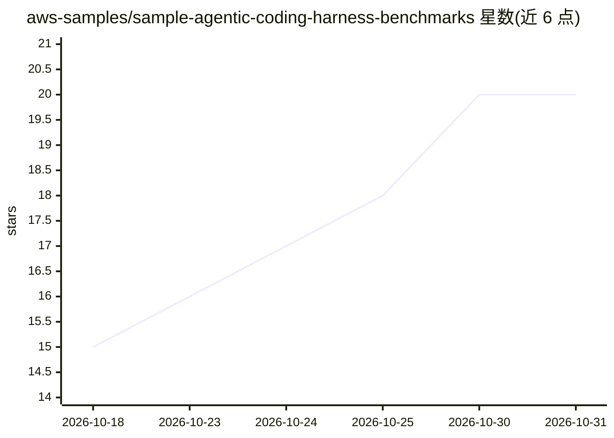

# aws-samples/sample-agentic-coding-harness-benchmarks

⭐ 20 · Python · MIT-0 · 推送 2026-10-28 · [GitHub](https://github.com/aws-samples/sample-agentic-coding-harness-benchmarks) · 组织维护

**编码 agent 跨模型基准工具与 swe-router 模型选型技能**

AWS samples 出品的样例仓库，包含两部分：基准测试 harness 驱动真实代码任务通过编码 agent（支持多种 agent 与三种托管路径：Bedrock 原生、经 LiteLLM 的 Bedrock、EC2 自托管 vLLM），由独立评审打分并生成成本/质量 Pareto 前沿；以及安装到开发者编码助手的 swe-router 技能，在任务前依据前沿数据推荐满足质量门槛的最低成本模型（仅推荐不切换）。明确声明为演示/学习用样例代码，不建议生产使用；发布结果中模型名为占位符。技能安装仅需 python3 3.8+。

## 筛选速览

| 维度 | 判定 | 备注 |
|---|---|---|
| AI 角色 | `ai-ecosystem` | LLM/agent 周边工具 |
| 许可风险 | `permissive` | MIT-0 |
| 部署形态 | `None` |  |
| 模型依赖 | local-ok | 支持本地模型 |
| 硬件要求 | — | 无带数字的原话,不猜 |
| 安装摩擦 | `low` | 无编译、无系统依赖或容器化 |
| 成熟度 | `idea` | |

## 能力要点

- 基准 harness 生成按仓库的成本/质量 Pareto 前沿
- 支持 Bedrock / LiteLLM 代理 / 自托管 vLLM 三种托管路径
- swe-router 技能按难度桶推荐最低成本达标模型
- 可对任意 GitHub 仓库编写数据集 YAML 进行自有基准

## 适用场景

- 平台团队定期跑基准，产出本团队代码上的模型成本/质量前沿
- 开发者编码助手内按任务难度获得模型选型建议
- 在自有私有仓库上复现基准而不将代码提交进版本控制

## 场景标签

`模型评测` · 领域:评测与运维

## 证据(README 行号)

> L26: 1. **The benchmark harness** drives real coding tasks from real repositories through a coding agent, across models 
> L27: 2. **`swe-router`** installs into a developer's coding assistant. Before a substantial task it reads that frontier 

## 星数曲线

2026-10-18 15 → 2026-10-31 20（+5）

---
*卡片 v1 · prompt 1.4 · 生成 2026-10-29 · 置信度 high · 依据 README sha `2f0517603936` · [字段定义](../../DATASET.md)*
