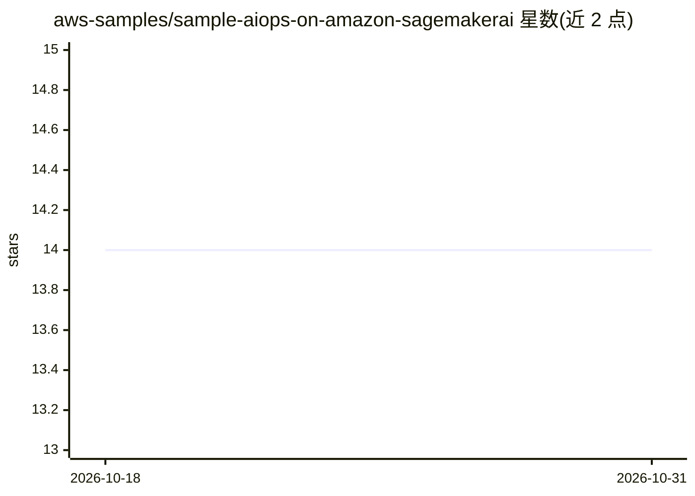

# aws-samples/sample-aiops-on-amazon-sagemakerai

⭐ 14 · Jupyter Notebook · MIT-0 · 推送 2026-09-15 · [GitHub](https://github.com/aws-samples/sample-aiops-on-amazon-sagemakerai) · 组织维护

**AWS 官方 GenAI/ML 运维（ModelOps）示例与研讨会集合**

aws-samples 维护的示例仓库，围绕 Amazon SageMakerAI 展开 GenAIOps/MLOps 实践：提供 MLflow 管理与版本迁移指南（v2.16/v3.0 迁至 v3.4）、基于 Evidently AI 的批量和端点监控管线、Athena/Grafana 的漂移与可观测性方案、LLM 推理与质量监控（Bedrock Claude 作 LLM-as-judge），以及 Strands Agents 可观测性示例。面向 ML 管理员、平台工程师、数据科学家与 DevOps 工程师，通过 notebooks、脚本与 CDK 配置交付。

## 筛选速览

| 维度 | 判定 | 备注 |
|---|---|---|
| AI 角色 | `ai-ecosystem` | LLM/agent 周边工具 |
| 许可风险 | `permissive` | MIT-0 |
| 部署形态 | `None` |  |
| 模型依赖 | — | README 未给出锁定关系 |
| 硬件要求 | — | 无带数字的原话,不猜 |
| 安装摩擦 | `low` | 无编译、无系统依赖或容器化 |
| 成熟度 | — | 结构信号不足 |

## 能力要点

- SageMaker 托管 MLflow 管理与跨版本迁移（含 experiments/runs/traces/prompts）
- Evidently AI 批量与端点的数据漂移、数据/模型质量监控管线
- Grafana 端点基础设施与 LLM 输出质量可观测性（Bedrock Claude 作 LLM-as-judge）
- Strands Agents on Bedrock AgentCore 的 MLflow 可观测性示例

## 适用场景

- 学习 SageMaker 托管 MLflow 的管理与示例工作负载
- 搭建批量和实时的 ML 数据漂移与模型质量监控
- 为 LLM 端点部署推理监控与质量评分看板

## 场景标签

`LLM 可观测性` `MLOps` · 领域:评测与运维

## 证据(README 行号)

> L3: This repository contains a collection of examples and resources to help you operationalize Generative AI (GenAI) and
> L6: The AWS ModelOps covering GenAIOps and MLOps patterns involing SageMakerAI resources like SageMaker managed MLflow, 

## 星数曲线

2026-10-18 14 → 2026-10-31 14（+0）

---
*卡片 v1 · prompt 1.4 · 生成 2026-10-31 · 置信度 high · 依据 README sha `110746f93572` · [字段定义](../../DATASET.md)*
