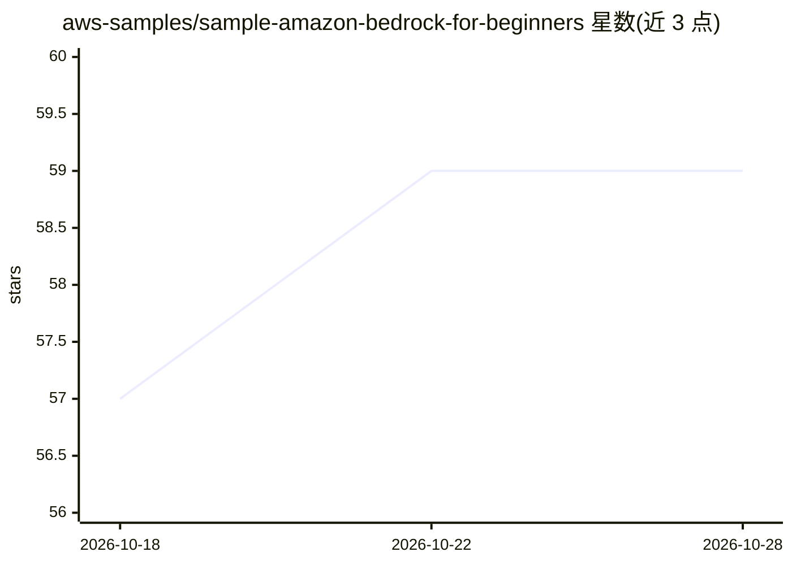

# aws-samples/sample-amazon-bedrock-for-beginners

⭐ 59 · Python · MIT-0 · 推送 2026-07-15 · [GitHub](https://github.com/aws-samples/sample-amazon-bedrock-for-beginners) · 组织维护

**Amazon Bedrock 入门教程代码集：从首个 API 调用到构建 AI agent**

配套 YouTube 视频与博客的代码示例仓库，面向初学者逐步演示用 Amazon Bedrock 构建 AI 应用：Converse API 基础调用、多轮对话、工具调用（function calling）、基于 Knowledge Bases 的 RAG（含 S3 向量存储配置步骤）、Guardrails 内容安全过滤，最终用 Strands Agents SDK 组合出大学 FAQ 聊天机器人 agent。需 AWS 账号与本地凭证，Python 3.12+，教程附资源清理与故障排查说明。

## 筛选速览

| 维度 | 判定 | 备注 |
|---|---|---|
| AI 角色 | `ai-knowledge` | 知识聚合/清单类 |
| 许可风险 | `permissive` | MIT-0 |
| 部署形态 | `library` | 以包/库形式分发 |
| 模型依赖 | locked-api |  |
| 硬件要求 | — | 无带数字的原话,不猜 |
| 安装摩擦 | `low` | 无编译、无系统依赖或容器化 |
| 成熟度 | — | 结构信号不足 |

## 能力要点

- 6 个递进式可运行示例：从 Converse API 到 Strands agent
- 覆盖 Knowledge Base RAG、Guardrails 内容过滤、工具调用
- 大学 FAQ 聊天机器人 capstone 项目（含 10 份 FAQ 文档）
- 提供 S3 Vectors 与 Managed Knowledge Base 两种配置路径

## 适用场景

- 跟着教程学习在 AWS 上用 Bedrock 构建 AI 应用
- 参考 Converse API、工具调用、RAG 的实现代码
- 了解 Bedrock Guardrails 内容安全配置流程

## 场景标签

`教程课程` `RAG` · 领域:知识与检索

## 证据(README 行号)

> L3: Companion repo for the YouTube video and blog: **Amazon Bedrock for Beginners – From First Prompt to AI Agent**
> L5: This repo contains code samples that take you from your first Bedrock API call to a fully working AI agent. By the e

## 星数曲线

2026-10-18 57 → 2026-10-28 59（+2）

---
*卡片 v1 · prompt 1.4 · 生成 2026-10-24 · 置信度 high · 依据 README sha `bd1899817f45` · [字段定义](../../DATASET.md)*
