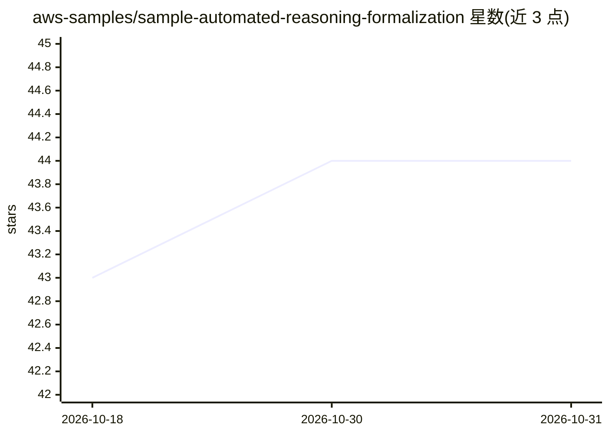

# aws-samples/sample-automated-reasoning-formalization

⭐ 44 · TypeScript · MIT-0 · 推送 2026-09-10 · [GitHub](https://github.com/aws-samples/sample-automated-reasoning-formalization) · [官网](https://docs.aws.amazon.com/bedrock/latest/userguide/guardrails-automated-reasoning-checks.html) · 组织维护

**帮非技术专家把文档形式化为 Bedrock 自动推理策略的桌面应用**

AWS samples 出品的 Electron 桌面应用 ARchitect：面向会计师、HR、律师等非技术领域专家，将其文档形式化为 Automated Reasoning 策略，供 Amazon Bedrock Guardrails 的 AR 检查使用。底层调用 Bedrock AR 控制面 API，并通过 Kiro CLI 的 Agent Client Protocol 接口使用 Anthropic Opus 4.6 进行文档推理与测试修复（对话式修测试），账户按 Kiro CLI 用量计费。需 Node.js 18+、npm、AWS 凭证与 Kiro CLI，从源码克隆安装，含基准测试与报告生成。

## 筛选速览

| 维度 | 判定 | 备注 |
|---|---|---|
| AI 角色 | `ai-ecosystem` | LLM/agent 周边工具 |
| 许可风险 | `permissive` | MIT-0 |
| 部署形态 | `library` | 以包/库形式分发 |
| 模型依赖 | locked-api |  |
| 硬件要求 | — | 无带数字的原话,不猜 |
| 安装摩擦 | `low` | 无编译、无系统依赖或容器化 |
| 成熟度 | — | 结构信号不足 |

## 能力要点

- 把文档形式化为 Bedrock Guardrails 可用的 AR 策略
- 通过 Kiro CLI（Opus 4.6）进行文档推理与对话式测试修复
- 基准测试评估 agent 策略修复表现并生成 HTML 报告（含 LLM-as-judge）
- 支持会话状态导出与调试可视化

## 适用场景

- 把公司报销、合规等制度文档转成自动推理策略
- 非技术人员不写代码即可创建和测试 AR 策略
- 通过对话让 agent 修复未通过的策略测试

## 场景标签

`AI 助手` · 领域:对话与助手

## 证据(README 行号)

> L3: A sample desktop application that helps non-technical subject matter experts (accountants, HR representatives, lawye
> L6: > ARchitect uses Anthropic Opus 4.6 through Kiro CLI to perform advanced reasoning about the source document, its fo

## 星数曲线

2026-10-18 43 → 2026-10-31 44（+1）

---
*卡片 v1 · prompt 1.4 · 生成 2026-10-25 · 置信度 high · 依据 README sha `5fe55ca5101f` · [字段定义](../../DATASET.md)*
