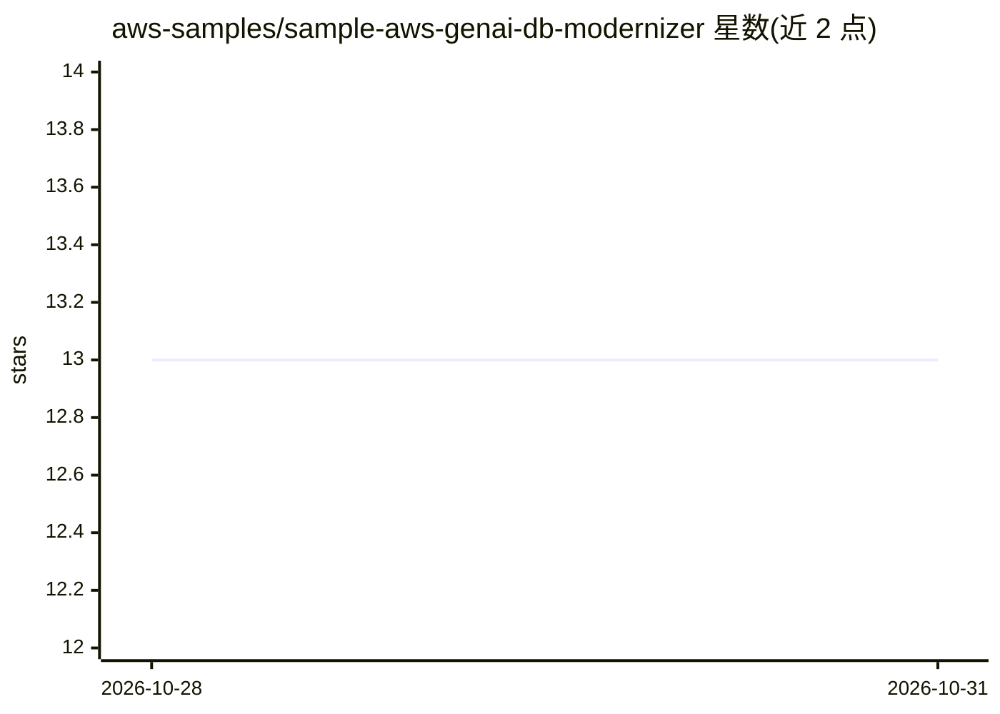

# aws-samples/sample-aws-genai-db-modernizer

⭐ 13 · Python · MIT-0 · 推送 2026-10-30 · [GitHub](https://github.com/aws-samples/sample-aws-genai-db-modernizer) · [官网](https://aws-samples.github.io/sample-aws-genai-db-modernizer/) · 组织维护

**面向 AWS 数据库现代化重构的查询分流评估与报告生成工具**

读取关系型数据库（PostgreSQL/MySQL/MariaDB/SQL Server/Oracle）的 schema 与查询统计，将每条查询按评分匹配到 AWS 专用引擎（DynamoDB/DocumentDB/Aurora/ElastiCache/OpenSearch），并生成目标 schema 设计、分波次迁移路线图、成本预估及高管/工程报告。引擎分配由确定性评分决定，可审计；模型（通过 Claude Code 或 Amazon Bedrock）仅负责 schema 设计与执行摘要。也可用 --llm-mode none 在无模型无凭据下运行。面向已决定重构应用以使用专用数据库的团队。

## 筛选速览

| 维度 | 判定 | 备注 |
|---|---|---|
| AI 角色 | `ai-enhanced` | 去掉 AI 部分产品仍成立 |
| 许可风险 | `permissive` | MIT-0 |
| 部署形态 | `None` |  |
| 模型依赖 | — | README 未给出锁定关系 |
| 硬件要求 | — | 无带数字的原话,不猜 |
| 安装摩擦 | `low` | 无编译、无系统依赖或容器化 |
| 成熟度 | — | 结构信号不足 |

## 能力要点

- 确定性评分的查询→引擎分配，每次运行结果一致可审计
- 生成 schema 设计、迁移波次路线图、成本预估与多份报告（PDF/MD/JSON）
- 支持 --llm-mode none 无模型无凭据运行全流程（跳过 schema 设计）
- 采集脚本只读且不读取表数据行

## 适用场景

- 评估单体关系库中哪些查询应迁移到哪个 AWS 专用引擎
- 为已决定重构的应用生成目标 schema 与分波次迁移计划
- 向管理层输出成本预估与高管简报

## 场景标签

 · 领域:数据库/云迁移

## 证据(README 行号)

> L45: One command runs the whole pipeline with no model and no credentials, in seconds:
> L48: uv run python scripts/run_assessment.py --file docs/examples/wordpress/wordpress-collection.json --db wordpress --l
> L68: **Database Modernizer Assessment answers these questions using your real workload.** It scores every query against 

## 星数曲线

2026-10-28 13 → 2026-10-31 13（+0）

---
*卡片 v1 · prompt 1.4 · 生成 2026-10-31 · 置信度 mid · 依据 README sha `c73ad6405713` · [字段定义](../../DATASET.md)*
