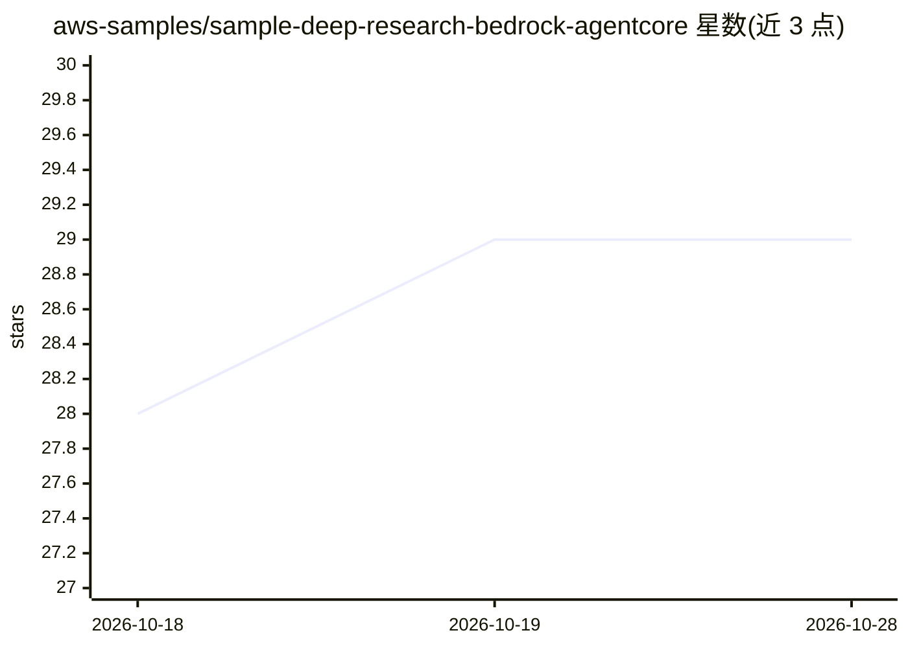

# aws-samples/sample-deep-research-bedrock-agentcore

⭐ 29 · Python · MIT-0 · 推送 2026-06-30 · [GitHub](https://github.com/aws-samples/sample-deep-research-bedrock-agentcore) · 组织维护

**部署到 AWS 的深度研究 agent，产出多维研究报告**

基于 Amazon Bedrock AgentCore 与 LangGraph 构建的研究 agent 示例工程：将研究主题分解为 2-5 个维度与研究问题，经 13 阶段工作流（规划、并行 ReAct 研究、综合、报告撰写、图表生成、文档转换）产出 Markdown/Word/PDF 报告。提供 React 前端聊天界面与对话 agent。通过 Terraform 脚本部署到 AWS，需 AWS 账号（Bedrock 已启用）、Terraform、Docker、Node.js 18+ 与 Python 3.11+。研究工具包括 DuckDuckGo、Google、Tavily、Wikipedia、ArXiv、金融数据 API 与沙箱代码解释器。

## 筛选速览

| 维度 | 判定 | 备注 |
|---|---|---|
| AI 角色 | `ai-native` | 本体是模型或模型工具 |
| 许可风险 | `permissive` | MIT-0 |
| 部署形态 | `None` |  |
| 模型依赖 | locked-api |  |
| 硬件要求 | — | 无带数字的原话,不猜 |
| 安装摩擦 | `low` | 无编译、无系统依赖或容器化 |
| 成熟度 | — | 结构信号不足 |

## 能力要点

- 13 阶段研究工作流，Map-Reduce 并行分析与综合
- 14 个工具经 AgentCore Gateway 接入（搜索/Wikipedia/ArXiv/金融/代码解释器）
- Markdown/Word/PDF 报告输出并嵌入图表
- AgentCore Memory 提供带语义搜索的会话与研究记忆（6 个月保留）

## 适用场景

- 对复杂主题自动生成多维度的深度研究报告
- 基于 ArXiv/Wikipedia 做学术类主题调研
- 对研究报告继续对话提问（带上下文的 chat agent）

## 场景标签

`科研工具` · 领域:学习与行业

## 证据(README 行号)

> L3: AI-powered research agent that conducts multi-dimensional analysis using AWS Bedrock AgentCore and LangGraph.
> L111: ### 8. **Report Writing** → Create final comprehensive report

## 星数曲线

2026-10-18 28 → 2026-10-28 29（+1）

---
*卡片 v1 · prompt 1.4 · 生成 2026-10-26 · 置信度 high · 依据 README sha `307ec4158164` · [字段定义](../../DATASET.md)*
