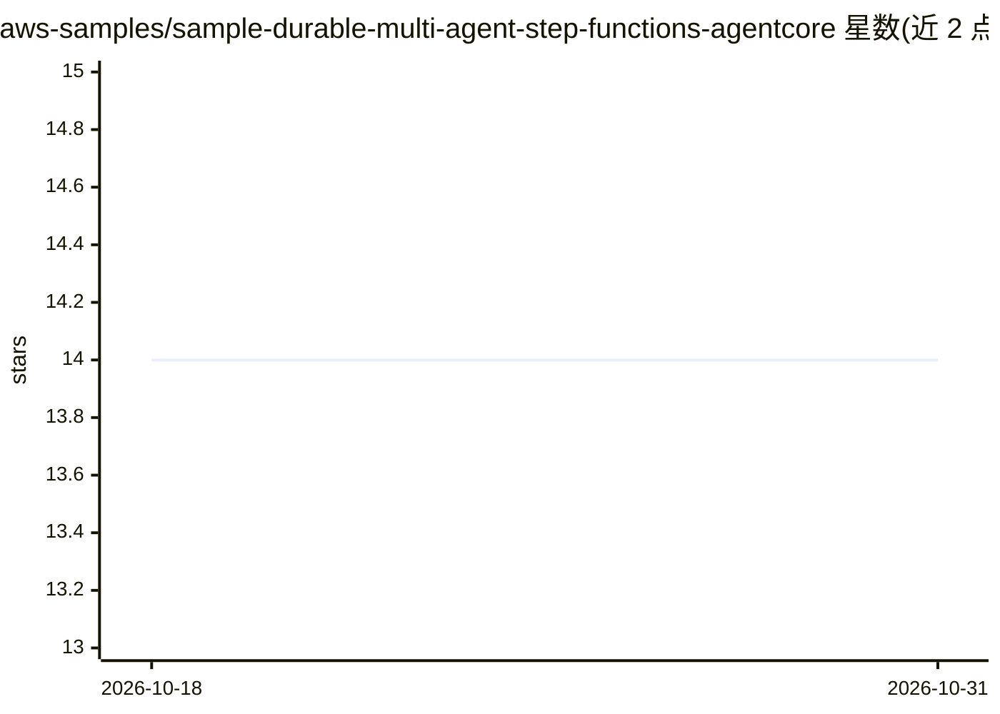

# aws-samples/sample-durable-multi-agent-step-functions-agentcore

⭐ 14 · Python · MIT-0 · 推送 2026-09-11 · [GitHub](https://github.com/aws-samples/sample-durable-multi-agent-step-functions-agentcore) · 组织维护

**AWS 示例：用 Step Functions 编排持久化多 agent 工作流**

aws-samples 出品的"产品发现助手"示例工程，演示以 AWS Step Functions 编排三个运行于 Amazon Bedrock AgentCore 的专用 agent（需求收集、产品搜索、设计校验），基于 Strands Agents SDK 构建，通过 Strands Graph 模式协调子 agent。展示回调令牌暂停/恢复、跨会话 Memory、DynamoDB 幂等与重试策略等模式。部署依赖多项计费 AWS 资源（测试估费 $5–20），API Gateway 默认无鉴权，README 明确标注为演示用途，生产部署需补充认证。

## 筛选速览

| 维度 | 判定 | 备注 |
|---|---|---|
| AI 角色 | `ai-ecosystem` | LLM/agent 周边工具 |
| 许可风险 | `permissive` | MIT-0 |
| 部署形态 | `self-host` | docker 或自建部署 |
| 模型依赖 | locked-api |  |
| 硬件要求 | — | 无带数字的原话,不猜 |
| 安装摩擦 | `low` | 无编译、无系统依赖或容器化 |
| 成熟度 | — | 结构信号不足 |

## 能力要点

- Step Functions 持久化编排：回调令牌实现零成本等待与暂停/恢复
- 三个专用 agent：需求收集、图模式产品搜索、热/电/合规校验
- AgentCore Memory 跨会话记忆（语义+偏好策略）
- DynamoDB 幂等键实现 exactly-once 样品下单

## 适用场景

- 学习在 AWS 上构建可暂停数日的持久化多 agent 工作流
- 参考 Step Functions + AgentCore + Strands SDK 的组合架构
- 了解幂等副作用与生产级错误处理模式的实现

## 场景标签

`多智能体` · 领域:Agent 开发

## 证据(README 行号)

> L3: A sample "Product Discovery Assistant" demonstrating how to build durable multi-agent workflows using AWS Step Funct
> L16: The system orchestrates three specialized AI agents through a Step Functions state machine:
> L19: 2. **SearchAgent** — Uses the Strands Graph pattern to coordinate catalog search, spec comparison, and recommendati

## 星数曲线

2026-10-18 14 → 2026-10-31 14（+0）

---
*卡片 v1 · prompt 1.4 · 生成 2026-10-31 · 置信度 mid · 依据 README sha `58f2b3dcda5f` · [字段定义](../../DATASET.md)*
