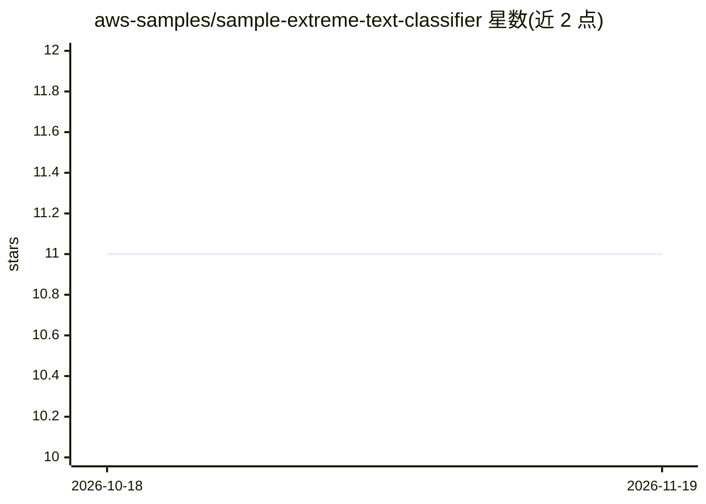

# aws-samples/sample-extreme-text-classifier

⭐ 11 · Python · MIT-0 · 推送 2026-02-14 · [GitHub](https://github.com/aws-samples/sample-extreme-text-classifier) · 组织维护

**基于 Amazon Bedrock 的大规模多类文本分类 Python 库**

面向 1000+ 类别的文本分类 Python 库，采用三步流水线：必选的嵌入语义检索完成基础分类，可选的 LLM 重排序与属性验证提升置信度；每步输出独立分数（相似度、重排序、属性分）。支持多模态 LLM 提取 PDF 内容后分类，可用 LLM 生成合成数据集与属性定义。依赖 AWS 账号及 Bedrock 上已激活的指定模型，需 Python 3.8+ 与已配置的 AWS CLI。

## 筛选速览

| 维度 | 判定 | 备注 |
|---|---|---|
| AI 角色 | `ai-native` | 本体是模型或模型工具 |
| 许可风险 | `permissive` | MIT-0 |
| 部署形态 | `library` | 以包/库形式分发 |
| 模型依赖 | locked-api |  |
| 硬件要求 | — | 无带数字的原话,不猜 |
| 安装摩擦 | `low` | 无编译、无系统依赖或容器化 |
| 成熟度 | — | 结构信号不足 |

## 能力要点

- 语义检索 + LLM 重排序 + 属性验证的三步分类流水线
- 支持 1000+ 类别与多模态 PDF 内容提取分类
- LLM 生成合成数据集与类别属性定义
- 各步骤提供独立分数与条件命中明细

## 适用场景

- 将发票、合同、报告等文档分类到 1000+ 类别
- 电商商品与零部件目录的分类
- 对分类结果按业务规则做属性校验
- 缺少类别定义时用 LLM 生成领域数据集

## 场景标签

`语义搜索` `文档解析` · 领域:知识与检索

## 证据(README 行号)

> L3: A Python text classifier for large-scale multi-class classification tasks with 1000+ classes using Amazon Bedrock. S
> L18: The classifier uses a **3-step pipeline** that combines semantic understanding with optional quality enhancements:
> L27: ### 1. 🔍 Semantic Search (Required)

## 星数曲线

2026-10-18 11 → 2026-11-19 11（+0）

---
*卡片 v1 · prompt 1.4 · 生成 2026-11-18 · 置信度 high · 依据 README sha `1bf924206b0c` · [字段定义](../../DATASET.md)*
