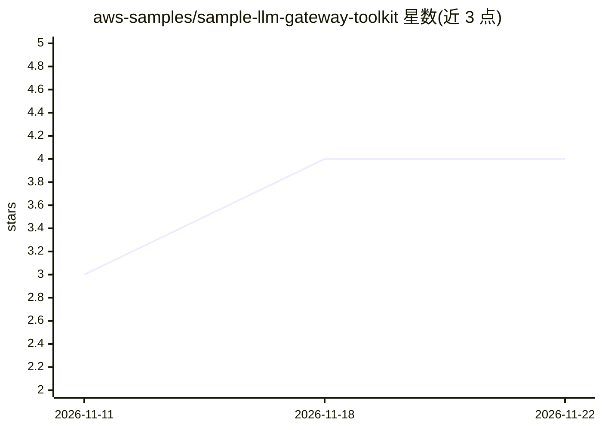

# aws-samples/sample-llm-gateway-toolkit

⭐ 4 · TypeScript · MIT-0 · 推送 2026-10-30 · [GitHub](https://github.com/aws-samples/sample-llm-gateway-toolkit) · 组织维护

**为企业在 AWS 上部署受控 LLM 网关，统一管理编码助手接入**

由 AWS 官方提供的部署工具集，核心是在 AWS 上运行 LiteLLM 网关，插入在编码代理与外部模型提供方之间。功能包括：虚拟密钥与花费追踪（Aurora PostgreSQL）、按用户/团队归属用量与预算、通过 IAM 原生接入 Bedrock 托管模型与 SageMaker 自托管模型、私有（SSM 隧道）或公开（CloudFront+Cognito）两种访问方式，以及基准测试组件用于在自有编码任务上比较模型。组件含 CDK 部署、CLI、Docker Compose 本地网关与 SageMaker vLLM 自托管示例。面向企业管理编码助手的团队。

## 筛选速览

| 维度 | 判定 | 备注 |
|---|---|---|
| AI 角色 | `ai-ecosystem` | LLM/agent 周边工具 |
| 许可风险 | `permissive` | MIT-0 |
| 部署形态 | `self-host` | docker 或自建部署 |
| 模型依赖 | local-ok | 支持本地模型 |
| 硬件要求 | — | 无带数字的原话,不猜 |
| 安装摩擦 | `low` | 无编译、无系统依赖或容器化 |
| 成熟度 | — | 结构信号不足 |

## 能力要点

- 在 ECS Fargate 私有子网部署 LiteLLM 网关，Aurora PostgreSQL 存储虚拟密钥与花费记录
- Bedrock 托管模型与 SageMaker 自托管模型经同一网关并发使用
- 提供基准测试组件，采集输出、token、成本、延迟与隐藏测试结果
- 本地开发用 Docker Compose 网关，与 AWS 网关使用相同模型配置格式

## 适用场景

- 为团队的 Copilot、Claude Code 等编码代理设置统一模型网关
- 按团队核算模型用量成本并设置预算
- 在更换模型前用自有任务实测质量与延迟
- 在 SageMaker 上自托管开源权重模型与 Bedrock 模型并用

## 场景标签

`模型网关` `模型评测` · 领域:Agent 开发

## 证据(README 行号)

> L15: Coding agents such as GitHub Copilot, Opencode or Claude Code talk straight to an external model provider. This too
> L37: LiteLLM runs on ECS Fargate in private subnets, with Aurora PostgreSQL as a storage backend for virtual keys and sp

## 星数曲线

2026-11-11 3 → 2026-11-22 4（+1）

---
*卡片 v1 · prompt 1.4 · 生成 2026-11-21 · 置信度 high · 依据 README sha `226dbdb544c2` · [字段定义](../../DATASET.md)*
