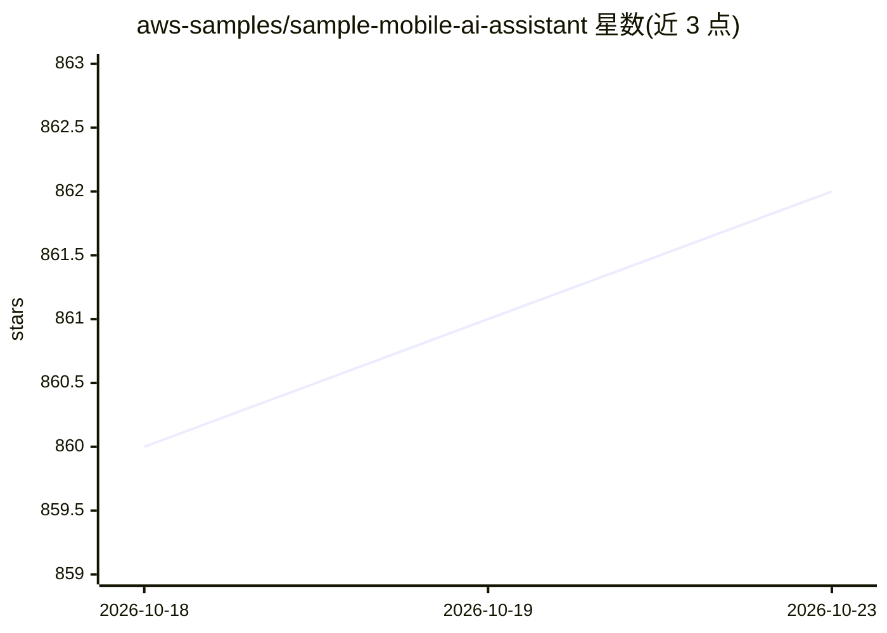

# aws-samples/sample-mobile-ai-assistant

⭐ 862 · TypeScript · MIT-0 · 推送 2026-10-19 · [GitHub](https://github.com/aws-samples/sample-mobile-ai-assistant) · 组织维护 · 中文 README

**AWS 出品的跨平台移动 AI 助手应用（聊天/生图/建应用）**

aws-samples 维护的 React Native 跨平台 AI 助手 App，运行于 Android、iOS 和 macOS。以 Amazon Bedrock 为主要模型来源，兼容 Ollama、DeepSeek、OpenAI 及 OpenAI Compatible 提供商。功能包括流式对话、AI 生图、一条提示词创建/编辑即时 Web 应用、网页搜索、多模态分析与语音对话（Nova Sonic）。后端可用 API Gateway + Lambda 一条命令部署。本地数据存储、不收集数据。

## 筛选速览

| 维度 | 判定 | 备注 |
|---|---|---|
| AI 角色 | `ai-native` | 本体是模型或模型工具 |
| 许可风险 | `permissive` | MIT-0 |
| 部署形态 | `desktop` | 安装包/桌面程序 |
| 模型依赖 | local-ok | 支持本地模型 |
| 硬件要求 | — | 无带数字的原话,不猜 |
| 安装摩擦 | `low` | 无编译、无系统依赖或容器化 |
| 成熟度 | — | 结构信号不足 |

## 能力要点

- 流式对话、AI 生图、即时 Web 应用创建与分享
- 支持 Amazon Bedrock/Ollama/DeepSeek/OpenAI/OpenAI Compatible 多模型
- Nova Sonic 语音对话与 Nova Canvas 虚拟试穿等图像功能
- AWS 一条命令部署 App Server（API Gateway + Lambda）

## 适用场景

- 在手机上使用多模型 AI 助手进行聊天与生图
- 用一条提示词生成并分享小型 Web 应用（2048、五子棋等）
- 配合自建 Ollama 服务器进行本地模型对话
- 通过 Nova Sonic 进行英语口语练习与讲故事

## 场景标签

`AI 助手` `图像生成` `代码生成` `语音 Agent` · 领域:编码与开发

## 证据(README 行号)

> L10: AI Assistant is a fast and responsive cross-platform app developed with React Native and
> L13: it delivers real-time streaming conversations, AI image generation, instant web app creation and voice conversation
> L156: - Real-time streaming chat with AI

## 星数曲线

2026-10-18 860 → 2026-10-23 862（+2）

---
*卡片 v1 · prompt 1.4 · 生成 2026-10-21 · 置信度 high · 依据 README sha `be385a1055f7` · [字段定义](../../DATASET.md)*
