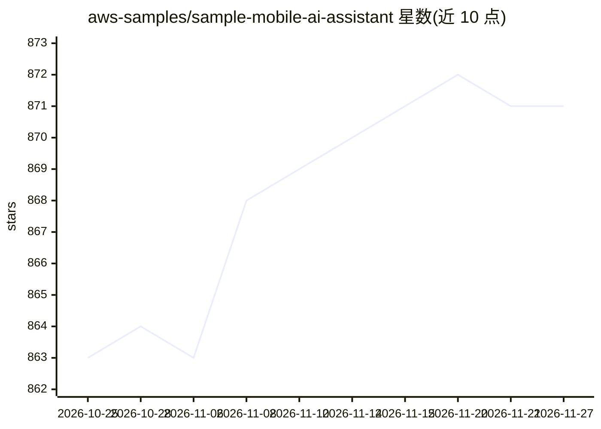

# aws-samples/sample-mobile-ai-assistant

⭐ 871 · TypeScript · MIT-0 · 推送 2026-11-26 · [GitHub](https://github.com/aws-samples/sample-mobile-ai-assistant) · 组织维护

**React Native 跨平台移动 AI 聊天与创作 App（Amazon Bedrock 驱动）**

aws-samples 提供的示例应用，用 React Native 构建，覆盖 Android、iOS、macOS。核心机制是通过 Amazon Bedrock 调用模型，并可配置 Ollama、DeepSeek、OpenAI 及 OpenAI 兼容端点作为模型来源；可选通过 API Gateway + Lambda 部署 App Server 以支持长时流式输出。功能包括流式对话、图像生成、一键生成 Web 应用、网页搜索、Nova Sonic 语音对话。数据仅存本地，API key 加密存储。

## 筛选速览

| 维度 | 判定 | 备注 |
|---|---|---|
| AI 角色 | `ai-native` | 本体是模型或模型工具 |
| 许可风险 | `permissive` | MIT-0 |
| 部署形态 | `desktop` | 安装包/桌面程序 |
| 模型依赖 | local-ok | 支持本地模型 |
| 硬件要求 | — | 无带数字的原话,不猜 |
| 安装摩擦 | `low` | 无编译、无系统依赖或容器化 |
| 成熟度 | — | 结构信号不足 |

## 能力要点

- 流式对话、图像生成、多模态输入（图片/视频/文档）
- 一键生成、编辑与分享 Web 应用
- Nova Canvas 虚拟试穿与去背景，Nova Sonic 语音对话（支持 Barge In 与回声消除）
- API Gateway + Lambda 一键部署 App Server，支持 15 分钟流式输出

## 适用场景

- 在手机上用 Amazon Bedrock 模型进行多模态 AI 对话
- 通过一句话生成并分享小型 Web 应用
- 用 Nova Sonic 做口语练习与语音聊天
- 连接本地 Ollama 服务在移动端使用本地模型

## 场景标签

`聊天机器人` `图像生成` `语音 Agent` · 领域:对话与助手

## 证据(README 行号)

> L10: AI Assistant is a fast and responsive cross-platform app developed with React Native and
> L14: capabilities across Android, iOS, and macOS platforms.
> L156: - Real-time streaming chat with AI

## 星数曲线

2026-10-25 863 → 2026-11-27 871（+8）

---
*卡片 v1 · prompt 1.4 · 生成 2026-11-24 · 置信度 high · 依据 README sha `b8f97222f502` · [字段定义](../../DATASET.md)*
