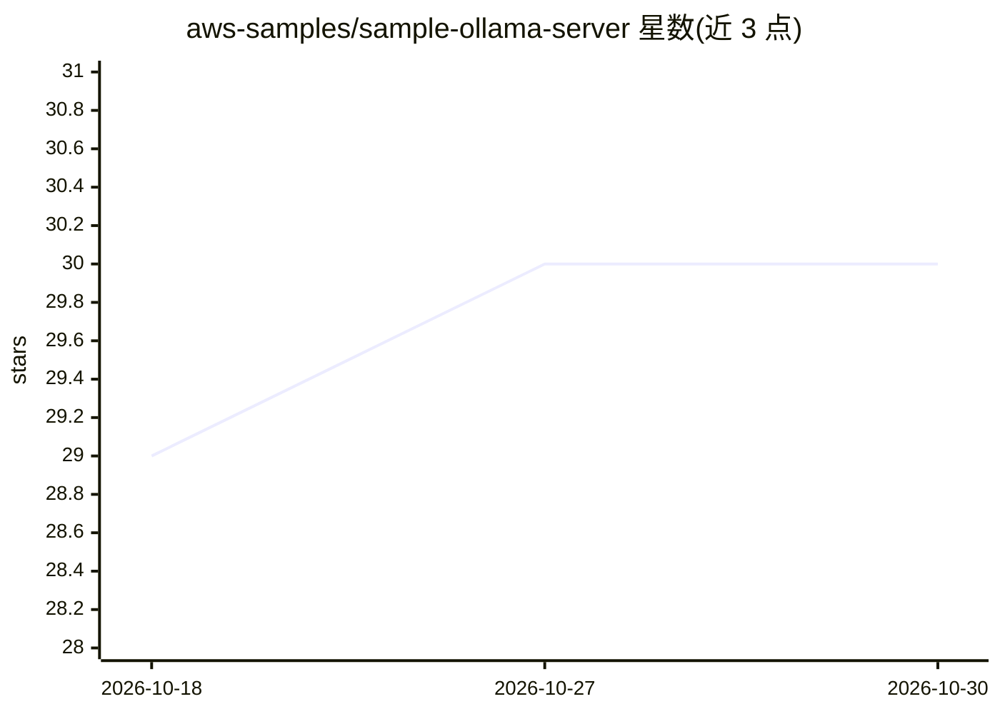

# aws-samples/sample-ollama-server

⭐ 30 · MIT-0 · 推送 2026-08-16 · [GitHub](https://github.com/aws-samples/sample-ollama-server) · 组织维护

**AWS CloudFormation 模板：一键部署 GPU EC2 上的 Ollama 与 Open WebUI**

由 aws-samples 提供的 CloudFormation 模板，在 AWS 上预置 NVIDIA GPU EC2 实例（x86_64 多代 G/P 系列，arm64 G5g）并安装 Ollama 与 Open WebUI；通过 LiteLLM 代理服务器接入 Amazon Bedrock 基础模型，并支持 Stable Diffusion 3.5 Large 或 Nova Canvas 图像生成（实验性）。可选组件包括 Amazon DCV 图形桌面、ALB/CloudFront、AWS Backup 与 SSM 远程管理。Open WebUI 与 LiteLLM 以 Docker compose 运行，配置文件位于 /opt/docker/。Anthropic 模型需先完成 First Time Use 表单。

## 筛选速览

| 维度 | 判定 | 备注 |
|---|---|---|
| AI 角色 | `ai-ecosystem` | LLM/agent 周边工具 |
| 许可风险 | `permissive` | MIT-0 |
| 部署形态 | `self-host` | docker 或自建部署 |
| 模型依赖 | local-ok | 支持本地模型 |
| 硬件要求 | — | 无带数字的原话,不猜 |
| 安装摩擦 | `low` | 无编译、无系统依赖或容器化 |
| 成熟度 | — | 结构信号不足 |

## 能力要点

- CloudFormation 一键预置 NVIDIA GPU EC2 实例与 Ollama/Open WebUI
- 通过 LiteLLM 代理接入 Amazon Bedrock 基础模型
- 支持 Stable Diffusion 3.5 Large / Nova Canvas 图像生成（实验性）
- 可选 Amazon DCV 图形桌面、ALB/CloudFront、AWS Backup

## 适用场景

- 在 AWS 上快速搭建自托管 LLM 运行与对话环境
- 通过 Open WebUI 同时使用本地 Ollama 模型与 Bedrock 托管模型
- 搭建带 GPU 的生成式 AI 应用开发环境（DCV 图形桌面）

## 场景标签

`推理引擎` · 领域:训练与推理

## 证据(README 行号)

> L7: This repo provides a AWS CloudFormation template to provision NVIDIA GPU EC2 instances with Ollama and Open WebUI, a
> L27:  - Ollama for running and managing LLMs
> L29:  - Amazon Bedrock model access through LiteLLM proxy server

## 星数曲线

2026-10-18 29 → 2026-10-30 30（+1）

---
*卡片 v1 · prompt 1.4 · 生成 2026-10-26 · 置信度 mid · 依据 README sha `e9aefcec6198` · [字段定义](../../DATASET.md)*
