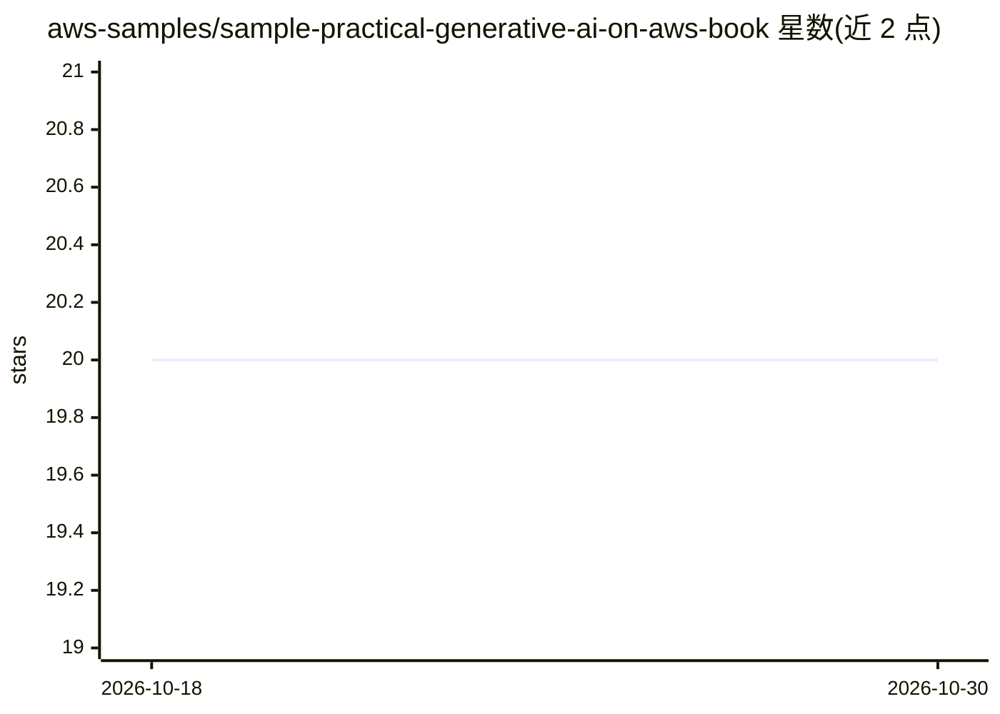

# aws-samples/sample-practical-generative-ai-on-aws-book

⭐ 20 · HTML · MIT-0 · 推送 2026-05-14 · [GitHub](https://github.com/aws-samples/sample-practical-generative-ai-on-aws-book) · [官网](https://www.amazon.co.jp/dp/4296205234) · 组织维护

**日文书《AWS生成AIアプリ構築実践ガイド》配套示例代码仓库**

aws-samples 组织下的书籍配套代码仓库，收录《AWS生成AIアプリ構築実践ガイド》（AWS 生成式 AI 应用构建实践指南）使用的示例代码。README 说明第 7 章需克隆另一官方示例仓库 bedrock-multi-agents-collaboration-workshop 配合使用，主题标签指向 Bedrock 与 agent 相关内容。采用 MIT-0 许可证发布，由 AWS 官方 samples 组织维护。

## 筛选速览

| 维度 | 判定 | 备注 |
|---|---|---|
| AI 角色 | `ai-knowledge` | 知识聚合/清单类 |
| 许可风险 | `permissive` | MIT-0 |
| 部署形态 | `None` |  |
| 模型依赖 | — | README 未给出锁定关系 |
| 硬件要求 | — | 无带数字的原话,不猜 |
| 安装摩擦 | `low` | 无编译、无系统依赖或容器化 |
| 成熟度 | — | 结构信号不足 |

## 能力要点

- 书籍配套示例代码集合
- 第 7 章需配合 bedrock-multi-agents-collaboration-workshop 仓库运行
- MIT-0 许可证

## 适用场景

- 随书学习 AWS 生成式 AI 应用构建
- 获取书中各章节的可运行示例代码

## 场景标签

`教程课程` · 领域:学习与行业

## 证据(README 行号)

> L1: ## 書籍「AWS生成AIアプリ構築実践ガイド」
> L2: 書籍「AWS生成AIアプリ構築実践ガイド」で使用するコードをまとめたリポジトリです (Amazon からご購入頂けます)。

## 星数曲线

2026-10-18 20 → 2026-10-30 20（+0）

---
*卡片 v1 · prompt 1.4 · 生成 2026-10-28 · 置信度 mid · 依据 README sha `36f3cd602414` · [字段定义](../../DATASET.md)*
