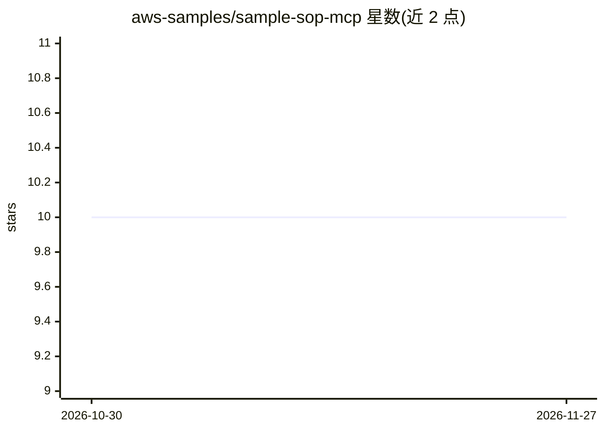

# aws-samples/sample-sop-mcp

⭐ 10 · Python · MIT-0 · 推送 2026-11-14 · [GitHub](https://github.com/aws-samples/sample-sop-mcp) · 组织维护

**把流程转为 SOP，供 AI 代理逐步执行的可审计 MCP 服务器**

一个 MCP 服务器，将可重复的多步流程编写为标准操作程序（SOP），按步骤逐一下发给 MCP 客户端中的 AI 代理执行：每一步必须产出结果才能进入下一步，进度显式记录，便于审计。内置 SOP 编写指南，通过对话完成草拟、lint 校验与发布；首次运行时预置 4 个 SOP（代码评审、入职配置等）。通过 uvx 一键运行，支持 Kiro/Cursor/VS Code 一键安装，也可手动配置到任意 MCP 客户端。README 提示 SOP 内容按不可信处理，存在提示注入风险。

## 筛选速览

| 维度 | 判定 | 备注 |
|---|---|---|
| AI 角色 | `ai-ecosystem` | LLM/agent 周边工具 |
| 许可风险 | `permissive` | MIT-0 |
| 部署形态 | `None` |  |
| 模型依赖 | — | README 未给出锁定关系 |
| 硬件要求 | — | 无带数字的原话,不猜 |
| 安装摩擦 | `low` | 无编译、无系统依赖或容器化 |
| 成熟度 | — | 结构信号不足 |

## 能力要点

- 步骤门控执行：每步产出结果才放行下一步，进度显式跟踪
- 内置对话式 SOP 编写指南，含 RFC 2119（MUST/SHOULD/MAY）约束与 lint 校验
- 首次运行预置 4 个可运行 SOP
- 提供 list_resources/run_sop/lint_sop/publish_sop 等 6 个 MCP 工具

## 适用场景

- 让代理按固定流程做代码评审，人工在每步检查输出
- 把新员工 IT 入职配置交给代理逐项执行
- 团队将发布流程固化为可审计、可复用的 SOP

## 场景标签

`工作流自动化` · 领域:效率与自动化

## 证据(README 行号)

> L7: An MCP server that hands a procedure to your AI assistant one step at a time and asks it to produce concrete output 
> L82: Each step tells the agent to *execute* — not just read. It must produce the step's expected output before advancing

## 星数曲线

2026-10-30 10 → 2026-11-27 10（+0）

---
*卡片 v1 · prompt 1.4 · 生成 2026-11-19 · 置信度 high · 依据 README sha `07a615407b89` · [字段定义](../../DATASET.md)*
