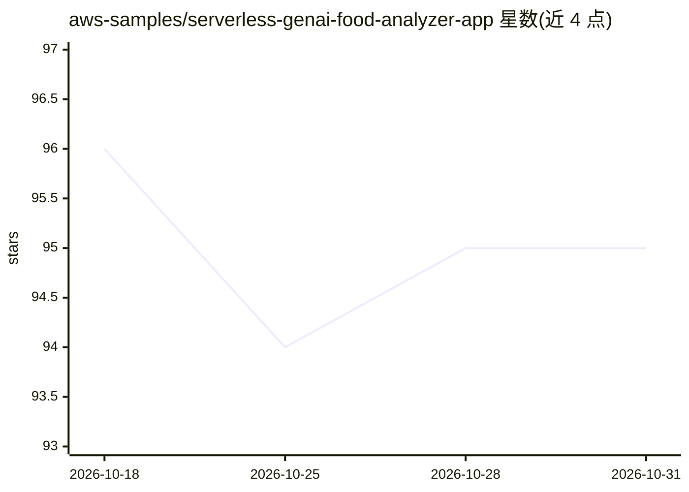

# aws-samples/serverless-genai-food-analyzer-app

⭐ 95 · TypeScript · MIT-0 · 推送 2026-04-06 · [GitHub](https://github.com/aws-samples/serverless-genai-food-analyzer-app) · 组织维护

**面向消费者的无服务器营养分析 Web 应用：扫码与拍照生成个性化食谱**

AWS 官方示例仓库，构建于 AWS CDK 无服务器架构（Cognito、Lambda URL、DynamoDB、S3、CloudFront），后端调用 Amazon Bedrock 上的 Anthropic Claude 模型。功能两条主线：扫描商品条码后基于 Open Food Facts 数据给出成分/过敏原解释与按用户偏好定制的营养摘要；拍摄冰箱食材照片，由 Claude 3 Sonnet 视觉能力识别食材并生成 3 道按难度分级、符合饮食限制的食谱，配图由 Amazon Nova Canvas 生成。支持英/法/西/意/阿五种语言输出，采用懒加载与提示词哈希降低成本。

## 筛选速览

| 维度 | 判定 | 备注 |
|---|---|---|
| AI 角色 | `ai-native` | 本体是模型或模型工具 |
| 许可风险 | `permissive` | MIT-0 |
| 部署形态 | `library` | 以包/库形式分发 |
| 模型依赖 | locked-api |  |
| 硬件要求 | — | 无带数字的原话,不猜 |
| 安装摩擦 | `low` | 无编译、无系统依赖或容器化 |
| 成熟度 | — | 结构信号不足 |

## 能力要点

- 条码扫描 + Open Food Facts 数据的过敏原与营养个性化摘要
- Claude 3 Sonnet 视觉识别多图食材并生成 3 道分级食谱
- Nova Canvas 生成产品/食谱配图，两步 LLM 生成图像提示词
- Lambda URL 流式输出步骤食谱，懒加载降低成本

## 适用场景

- 购物时扫码查看商品成分是否适合自己的过敏与饮食限制
- 拍下冰箱食材获取可用原料的个性化食谱
- 作为 Bedrock + 无服务器架构的 GenAI 应用参考实现

## 场景标签

`AI 助手` `多模态` `图像生成` · 领域:对话与助手

## 证据(README 行号)

> L3: **Food analyzer app** is a personalized GenAI nutritional webapp for your shopping and cooking recipes built with se
> L57: - **Implementation**: Using AWS Lambda for server-side logic, Amazon Bedrock as a generative artificial intelligenc
> L91: - **Implementation**: We use Anthropic Claude 3 Sonnet on Amazon Bedrock with its vision capabilities to extract on

## 星数曲线

2026-10-18 96 → 2026-10-31 95（-1）

---
*卡片 v1 · prompt 1.4 · 生成 2026-10-23 · 置信度 high · 依据 README sha `8933ab15396c` · [字段定义](../../DATASET.md)*
