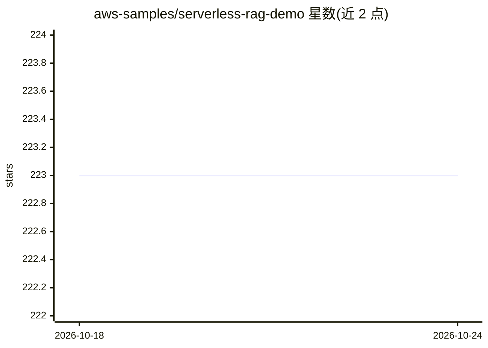

# aws-samples/serverless-rag-demo

⭐ 223 · Python · MIT-0 · 推送 2026-10-24 · [GitHub](https://github.com/aws-samples/serverless-rag-demo) · [官网](https://aws.amazon.com/blogs/big-data/build-scalable-and-serverless-rag-workflows-with-a-vector-engine-for-amazon-opensearch-serverless-and-amazon-bedrock-claude-models/) · 组织维护

**AWS 上部署的 Serverless RAG 文档问答与多 Agent 示例**

aws-samples 提供的参考实现：通过 AWS CDK（Python）一键部署文档聊天与多 Agent 工作流。文档聊天使用 OpenSearch Serverless NextGen 向量库与 BM25+KNN 混合检索，按用户隔离文档；多 Agent 用 Strands Graph 编排代码生成、演示文稿、网络搜索、天气、检索等专家节点。LLM 为 Claude Sonnet/Opus 4.6，嵌入为 Titan Embed V2。需 AWS 账号开通 Bedrock 模型访问、Python 3.12+、Node.js 20+、Docker 与 CDK CLI，运行 deploy.sh 部署，支持 7 个区域。

## 筛选速览

| 维度 | 判定 | 备注 |
|---|---|---|
| AI 角色 | `ai-native` | 本体是模型或模型工具 |
| 许可风险 | `permissive` | MIT-0 |
| 部署形态 | `library` | 以包/库形式分发 |
| 模型依赖 | locked-api |  |
| 硬件要求 | — | 无带数字的原话,不猜 |
| 安装摩擦 | `low` | 无编译、无系统依赖或容器化 |
| 成熟度 | — | 结构信号不足 |

## 能力要点

- 文档聊天：BM25+KNN 混合检索，按用户文档隔离
- Strands Graph 多 Agent 编排（代码生成/演示/搜索/天气/检索节点）
- CDK 单命令部署，OCU 支持 scale-to-zero 零空闲费用
- OpenSearch Serverless NextGen 作为向量库

## 适用场景

- 在 AWS 上快速搭建带文档隔离的 RAG 文档问答系统
- 参考 Serverless 多 Agent 工作流的架构与部署方式
- 体验 Bedrock Knowledge Base + AgentCore 的组合方案

## 场景标签

`文档问答` `RAG` `多智能体` · 领域:Agent 开发

## 证据(README 行号)

> L7: - **Document Chat** — Upload documents, ask questions with hybrid search (BM25 + KNN), per-user document isolation
> L28: |LLM|Claude Sonnet 4.6 / Opus 4.6 (global inference profiles)|

## 星数曲线

2026-10-18 223 → 2026-10-24 223（+0）

---
*卡片 v1 · prompt 1.4 · 生成 2026-10-22 · 置信度 mid · 依据 README sha `d0ae791047ff` · [字段定义](../../DATASET.md)*
