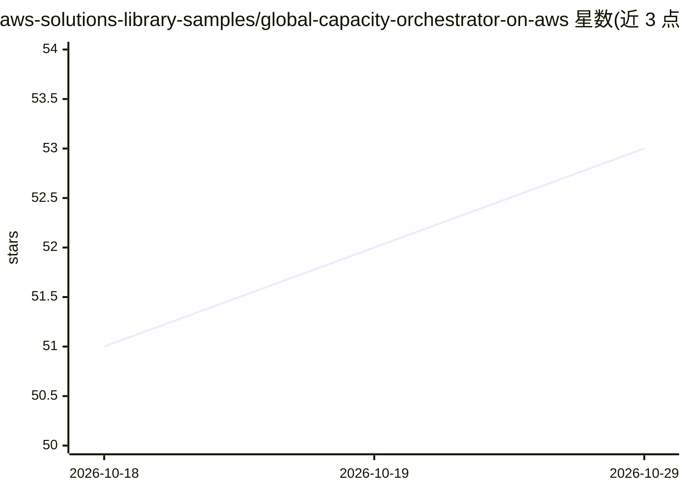

# aws-solutions-library-samples/global-capacity-orchestrator-on-aws

⭐ 53 · Python · MIT-0 · 推送 2026-10-28 · [GitHub](https://github.com/aws-solutions-library-samples/global-capacity-orchestrator-on-aws) · [官网](https://aws-solutions-library-samples.github.io/global-capacity-orchestrator-on-aws/) · 组织维护

**AWS 多区域加速算力编排平台：一个 API 调度 GPU 训练与推理**

AWS 官方 Solutions Guidance，将 LLM 训练/推理、批量 ML 与 HPC 工作负载运行在多区域 EKS Auto Mode 集群上，通过 SigV4 API、gco CLI 与 MCP server 统一访问。核心机制：读取 spot 放置分数与容量预留做容量感知调度，自动跨区部署 vLLM/SGLang/Triton 推理端点并通过 Global Accelerator 故障转移；默认集成 KEDA、Volcano、Kueue、KubeRay 等。通过 dev container 部署（git clone + 脚本），主机安装为非推荐路径；aws-cn 分区无全局加速器故障转移。

## 筛选速览

| 维度 | 判定 | 备注 |
|---|---|---|
| AI 角色 | `ai-ecosystem` | LLM/agent 周边工具 |
| 许可风险 | `permissive` | MIT-0 |
| 部署形态 | `self-host` | docker 或自建部署 |
| 模型依赖 | local-ok | 支持本地模型 |
| 硬件要求 | — | 无带数字的原话,不猜 |
| 安装摩擦 | `low` | 无编译、无系统依赖或容器化 |
| 成熟度 | — | 结构信号不足 |

## 能力要点

- 容量感知调度：读取 spot 分数/价格历史/容量预留并自动选择区域
- 一条命令跨区域部署 vLLM/SGLang/Triton 推理端点并自动故障转移
- SigV4 API + gco CLI + MCP server 统一访问，无需分发 kubeconfig
- 默认集成 KEDA/Volcano/Kueue/KubeRay/Prometheus/Grafana/MLflow

## 适用场景

- 在多区域间寻找 GPU/Trainium/Inferentia 容量并提交训练或推理任务
- 一处部署、多区域服务 LLM 推理端点并获得自动故障转移
- 通过 Claude Code/OpenAI Codex 等 agent 用自然语言管理算力集群

## 场景标签

`推理引擎` `模型训练` `MLOps` · 领域:训练与推理

## 证据(README 行号)

> L28: **Global Capacity Orchestrator (GCO)** runs accelerated workloads — LLM training and inference, batch ML, HPC — on 
> L41: - **Inference in every Region.** One command deploys vLLM, SGLang or Triton endpoints everywhere, with automatic fa

## 星数曲线

2026-10-18 51 → 2026-10-29 53（+2）

---
*卡片 v1 · prompt 1.4 · 生成 2026-10-24 · 置信度 high · 依据 README sha `22d83009148c` · [字段定义](../../DATASET.md)*
