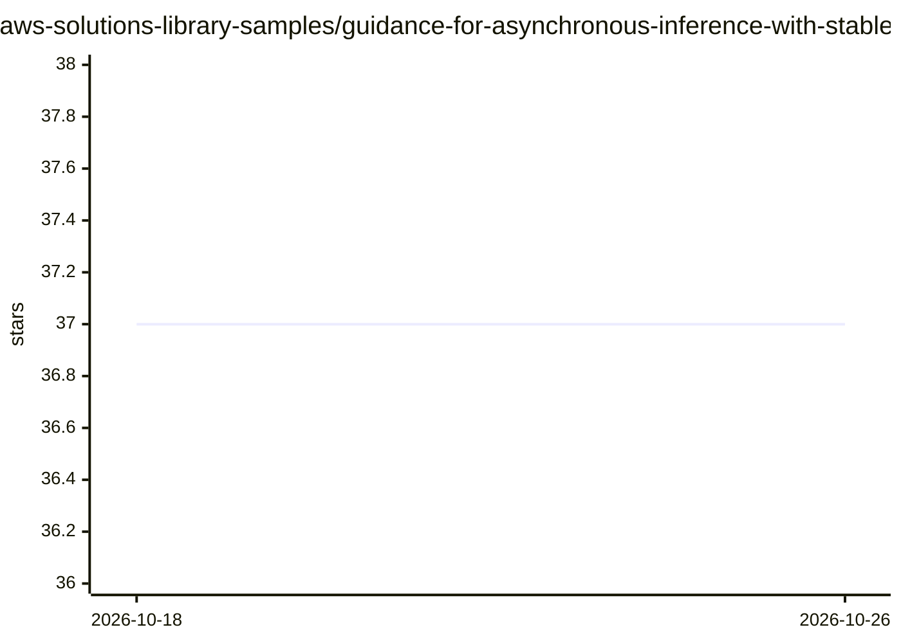

# aws-solutions-library-samples/guidance-for-asynchronous-inference-with-stable-diffusion-on-aws

⭐ 37 · Python · MIT-0 · 推送 2026-05-23 · [GitHub](https://github.com/aws-solutions-library-samples/guidance-for-asynchronous-inference-with-stable-diffusion-on-aws) · [官网](https://aws.amazon.com/solutions/guidance/asynchronous-image-generation-with-stable-diffusion-on-aws/) · 组织维护 · 中文 README

**AWS 上构建可弹性伸缩的 Stable Diffusion 异步推理部署方案**

AWS 官方 Guidance 项目：提供 CDK 部署脚本与示例代码，在 AWS 上搭建端到端的异步图像生成架构——API Gateway 接收 prompt，Lambda 校验后经 SNS/SQS 分发到按 SD runtime 区分的队列；EKS 集群中由 KEDA 按队列长度扩缩 Pod，Karpenter 启动 GPU EC2（g5/g6/p4，支持 Spot）计算节点，模型文件经 Mountpoint for S3 CSI 驱动从 S3 加载，生成图片存回 S3。面向需要在 AWS 上构建低成本弹性推理服务的架构师与开发者。README 提供按每百万张图片计的成本估算表。

## 筛选速览

| 维度 | 判定 | 备注 |
|---|---|---|
| AI 角色 | `ai-ecosystem` | LLM/agent 周边工具 |
| 许可风险 | `permissive` | MIT-0 |
| 部署形态 | `library` | 以包/库形式分发 |
| 模型依赖 | — | README 未给出锁定关系 |
| 硬件要求 | — | 无带数字的原话,不猜 |
| 安装摩擦 | `low` | 无编译、无系统依赖或容器化 |
| 成熟度 | — | 结构信号不足 |

## 能力要点

- SQS 队列长度驱动的 KEDA 自动扩缩容
- Karpenter v1 + GPU Spot EC2 实例（g5/g6/p4）自动供给计算节点
- SOCI 并行拉取 + NVMe 实例存储加速容器启动
- S3 + Mountpoint CSI 驱动加载 ML 模型文件

## 适用场景

- 在 AWS 上低成本部署可弹性伸缩的 Stable Diffusion 图像生成服务
- 处理突发量级的异步图像生成请求（事件驱动架构）
- 通过 CDK 脚本快速部署完整的异步推理参考架构

## 场景标签

`图像生成` `推理引擎` · 领域:内容生成

## 证据(README 行号)

> L6: This project shows how to use serverless architecture and container services to build an end-to-end low cost, rapidl
> L11: - Image Generation with open source Stable Diffusion runtimes running on Amazon EKS (Kubernetes 1.35)

## 星数曲线

2026-10-18 37 → 2026-10-26 37（+0）

---
*卡片 v1 · prompt 1.4 · 生成 2026-10-25 · 置信度 high · 依据 README sha `7db54bfa4e97` · [字段定义](../../DATASET.md)*
