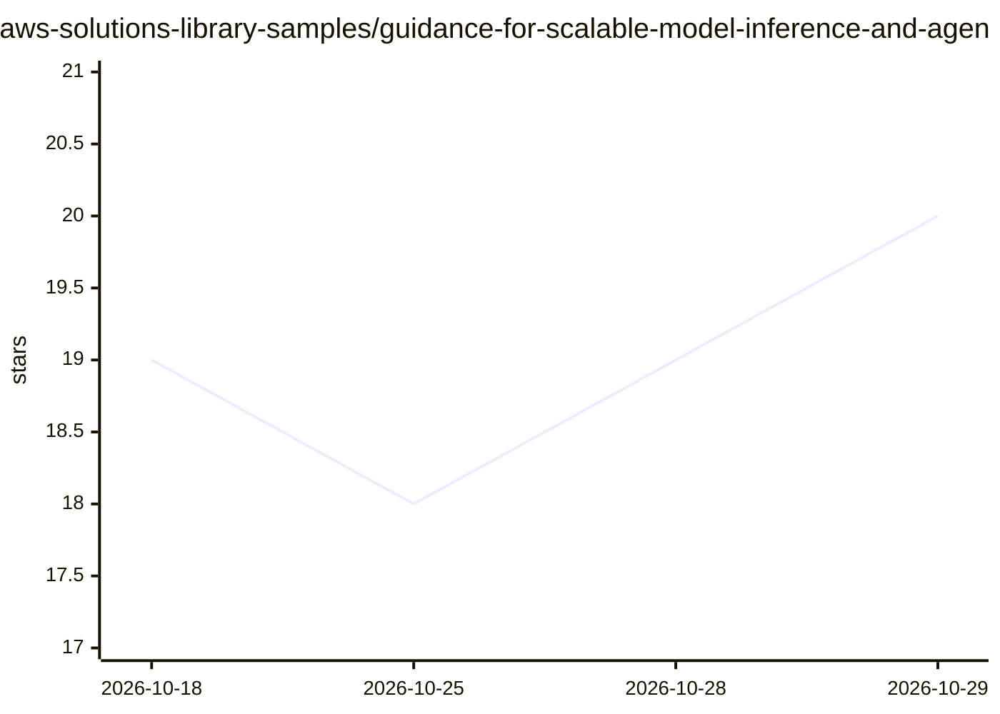

# aws-solutions-library-samples/guidance-for-scalable-model-inference-and-agentic-ai-on-amazon-eks

⭐ 20 · Python · MIT-0 · 推送 2026-09-04 · [GitHub](https://github.com/aws-solutions-library-samples/guidance-for-scalable-model-inference-and-agentic-ai-on-amazon-eks) · [官网](https://aws.amazon.com/solutions/guidance/scalable-model-inference-and-agentic-ai-on-amazon-eks/) · 组织维护

**AWS 参考架构：在 Amazon EKS 上部署可扩展的 LLM 推理与 Agentic AI 平台**

AWS Solutions Library 的部署指南（Guidance），在 Amazon EKS 上构建端到端 ML 推理平台：以 Karpenter 管理多种节点池（Graviton ARM64 CPU 推理、NVIDIA GPU、Inferentia），模型服务使用 Ray Serve 与 vLLM，LiteLLM 作 OpenAI 兼容网关；上层用 Strands Agent SDK 实现编排 Agent、RAG（OpenSearch）、文档处理、RAGAS 评估 Agent 与 Langfuse 追踪。面向在 AWS 上部署生产级 LLM/Agentic 工作负载的云架构师与平台团队，默认部署成本约 447 美元/月，支持 14 个 AWS 区域。

## 筛选速览

| 维度 | 判定 | 备注 |
|---|---|---|
| AI 角色 | `ai-ecosystem` | LLM/agent 周边工具 |
| 许可风险 | `permissive` | MIT-0 |
| 部署形态 | `None` |  |
| 模型依赖 | local-ok | 支持本地模型 |
| 硬件要求 | — | 无带数字的原话,不猜 |
| 安装摩擦 | `low` | 无编译、无系统依赖或容器化 |
| 成熟度 | — | 结构信号不足 |

## 能力要点

- Graviton CPU / NVIDIA GPU / Inferentia 多节点池混合推理架构
- LiteLLM 统一 OpenAI 兼容网关 + Ray Serve 分布式模型服务
- Strands Agent SDK 编排多 Agent 工作流（RAG、评估、Web 搜索兜底）
- Langfuse + Prometheus/Grafana 可观测性栈

## 适用场景

- 在 AWS 上搭建可弹性伸缩的 LLM 推理平台
- 部署带 RAG 与多 Agent 协作的 Agentic AI 应用
- 按成本或吞吐需求在 CPU 与 GPU 推理间选择节点方案

## 场景标签

`推理引擎` `模型网关` `多智能体` `LLM 可观测性` · 领域:Agent 开发

## 证据(README 行号)

> L6: This solution implements a comprehensive, scalable ML inference architecture using Amazon EKS with AutoMode, leverag
> L56: 3. **Orchestration and Analysis**: The orchestrator agent, powered by Strands Agent SDK, serves as the central coor

## 星数曲线

2026-10-18 19 → 2026-10-29 20（+1）

---
*卡片 v1 · prompt 1.4 · 生成 2026-10-29 · 置信度 high · 依据 README sha `c14c11806b10` · [字段定义](../../DATASET.md)*
