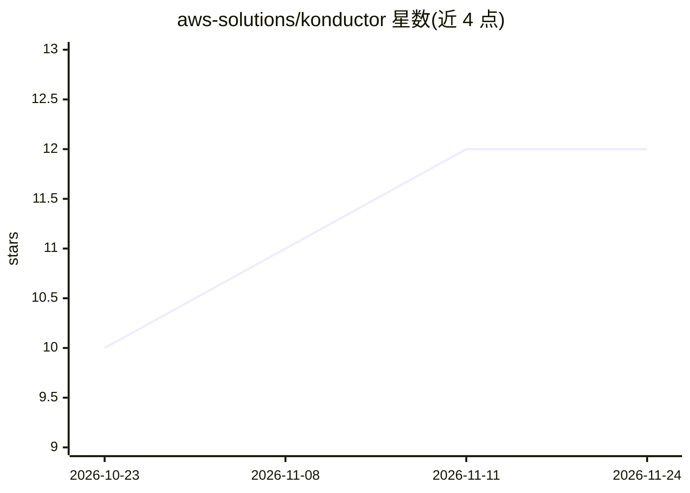

# aws-solutions/konductor

⭐ 12 · Rust · Apache-2.0 · 推送 2026-11-23 · [GitHub](https://github.com/aws-solutions/konductor) · [官网](https://aws-solutions.github.io/konductor/) · 组织维护

**为开发者提供覆盖 SDLC 的多 AI agent 团队编排**

Konductor 以配置（提示词、技能、SOP）形式安装到 Kiro CLI 或 Claude Code 运行时，提供 konductor 编排 agent 及产品经理、架构师、开发者、QA 等 10 个专职 agent，覆盖需求、设计、实现、测试与文档的软件开发生命周期；内置 81 个技能与 19 个工作流（SOP），每个阶段经独立 reviewer 或 checker 检查，失败检查有一次修复与复审机会。无服务器等基础设施，需用户自有运行时与模型额度；官方支持 Linux x86_64/aarch64 与 Apple Silicon macOS，其他平台需从源码构建（Rust/cargo）。

## 筛选速览

| 维度 | 判定 | 备注 |
|---|---|---|
| AI 角色 | `ai-native` | 本体是模型或模型工具 |
| 许可风险 | `permissive` | Apache-2.0 |
| 部署形态 | `None` |  |
| 模型依赖 | — | README 未给出锁定关系 |
| 硬件要求 | — | 无带数字的原话,不猜 |
| 安装摩擦 | `low` | 无编译、无系统依赖或容器化 |
| 成熟度 | — | 结构信号不足 |

## 能力要点

- 多 agent 编排：需求→设计→实现→测试→文档，阶段间校验交接
- 81 个技能与 19 个 SOP（威胁建模、IAM 策略、代码审查、E2E 测试等）
- 安装即配置，无服务器，直接由 Kiro 或 Claude Code 运行时执行
- 三种安装路径：引导脚本、Rust 源码构建、Kiro Power

## 适用场景

- 用自然语言让 agent 团队完成从需求到可评审代码的整个流程
- 为代码与文档（含 auth/密钥/基础设施相关改动）强制添加审查门
- 在既有 Kiro/Claude Code 工作流中加入多角色协作与质量检查

## 场景标签

`多智能体` `编码 Agent` `代码审查` · 领域:Agent 开发

## 证据(README 行号)

> L5: **A team of AI agents that takes your work from idea to reviewed code.**
> L31: - 🎼 **One request, the whole lifecycle.** Requirements, design, code, tests and docs, without
> L39: - 🪶 **No infrastructure.** Agents are configuration (prompts, skills, SOPs) that your Kiro or

## 星数曲线

2026-10-23 10 → 2026-11-24 12（+2）

---
*卡片 v1 · prompt 1.4 · 生成 2026-11-18 · 置信度 high · 依据 README sha `96f86f615402` · [字段定义](../../DATASET.md)*
