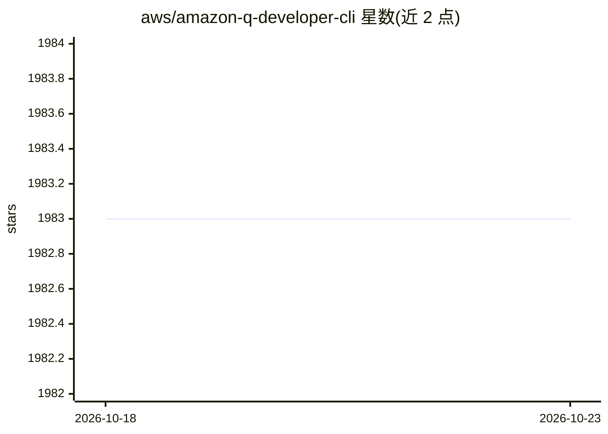

# aws/amazon-q-developer-cli

⭐ 1,983 · Rust · Apache-2.0 · 推送 2026-08-24 · [GitHub](https://github.com/aws/amazon-q-developer-cli) · [官网](https://docs.aws.amazon.com/amazonq/latest/qdeveloper-ug/command-line-installing.html) · 组织维护

**AWS 出品的终端 AI 聊天 CLI（已停止积极维护）**

Rust 编写的命令行工具 chat_cli（命令 q），让用户在终端中与 Amazon Q Developer 交互，通过自然语言对话构建应用程序，支持 MCP 相关生态标签。由 AWS 维护。README 声明本项目不再积极维护，仅接收关键安全修复，后续以闭源产品 Kiro CLI 提供。安装提供 macOS DMG、Homebrew cask 与 Linux AppImage 等构建，也可从源码用 cargo 编译运行。

## 筛选速览

| 维度 | 判定 | 备注 |
|---|---|---|
| AI 角色 | `ai-native` | 本体是模型或模型工具 |
| 许可风险 | `permissive` | Apache-2.0 |
| 部署形态 | `library` | 以包/库形式分发 |
| 模型依赖 | — | README 未给出锁定关系 |
| 硬件要求 | — | 无带数字的原话,不猜 |
| 安装摩擦 | `low` | 无编译、无系统依赖或容器化 |
| 成熟度 | — | 结构信号不足 |

## 能力要点

- Rust 实现的终端聊天 CLI，接入 Amazon Q Developer
- macOS 提供 DMG 与 Homebrew 安装，Linux 提供 AppImage
- 仓库含 chat_cli、crates、scripts、docs 等模块

## 适用场景

- 在终端通过自然语言与 AI 对话辅助开发
- 以 CLI 方式使用 Amazon Q Developer 服务

## 场景标签

`AI 助手` · 领域:对话与助手

## 证据(README 行号)

> L50: - `chat_cli` - the `q` CLI, allows users to interface with Amazon Q Developer from
> L4: > This open source project is no longer being actively maintained and will only receive critical security fixes. Ama

## 星数曲线

2026-10-18 1,983 → 2026-10-23 1,983（+0）

---
*卡片 v1 · prompt 1.4 · 生成 2026-10-21 · 置信度 high · 依据 README sha `8bbb39869561` · [字段定义](../../DATASET.md)*
