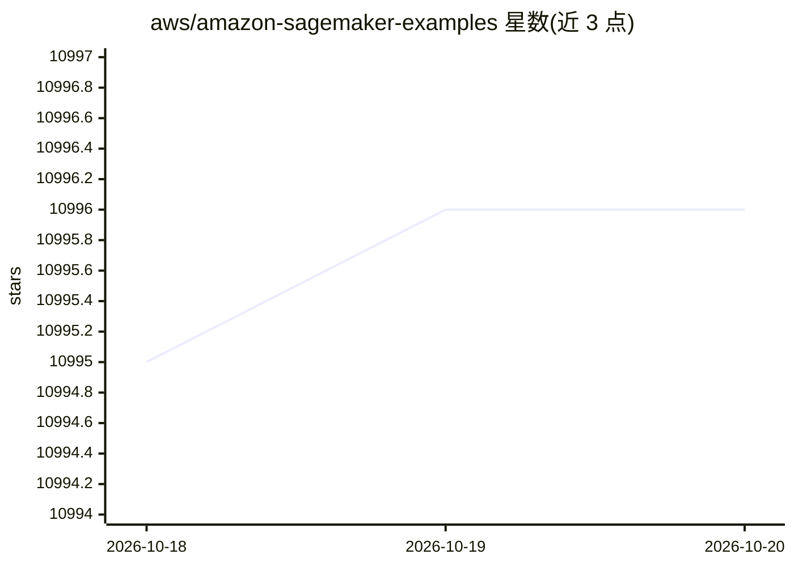

# aws/amazon-sagemaker-examples

⭐ 10,996 · Jupyter Notebook · Apache-2.0 · 推送 2026-10-14 · [GitHub](https://github.com/aws/amazon-sagemaker-examples) · [官网](https://sagemaker-examples.readthedocs.io) · 组织维护

**Amazon SageMaker 官方 Jupyter 示例集：构建/训练/部署 ML 模型**

由 Amazon SageMaker 团队维护的官方示例 notebook 仓库，按 ML 生命周期组织：训练（分布式、托管 spot、@remote）、模型定制（SFT/DPO/RLAIF/CPT 等微调）、评估（基准、LLM as judge、Inspect AI）、推理（端点、A/B 测试、部署到 Bedrock）与 MLOps（Pipelines、模型注册表、MLflow）。notebook 自动加载到 SageMaker Notebook Instance，也可在实例外经少量修改运行。运行需 AWS 账号、IAM 配置与 S3 桶；仓库只接受未被覆盖的 SageMaker 功能示例，其余提交至社区仓库。开头另宣传新的 SageMaker-Core Python SDK。

## 筛选速览

| 维度 | 判定 | 备注 |
|---|---|---|
| AI 角色 | `ai-knowledge` | 知识聚合/清单类 |
| 许可风险 | `permissive` | Apache-2.0 |
| 部署形态 | `None` |  |
| 模型依赖 | — | README 未给出锁定关系 |
| 硬件要求 | — | 无带数字的原话,不猜 |
| 安装摩擦 | `low` | 无编译、无系统依赖或容器化 |
| 成熟度 | — | 结构信号不足 |

## 能力要点

- 按 train→customize→evaluate→deploy→MLOps 生命周期组织示例类别
- 覆盖分布式训练、JumpStart 微调、A/B 测试与部署到 Bedrock 等 SageMaker 功能
- notebook 自包含（附带脚本/数据/镜像），可脱离 SageMaker 实例运行

## 适用场景

- 学习如何用 SageMaker Python SDK 构建训练与部署流水线
- 查找特定功能（如分布式微调、LLM 评估、A/B 发布）的参考 notebook
- 作为向社区仓库贡献示例前的覆盖范围检查基准

## 场景标签

`微调` `MLOps` `教程课程` · 领域:学习与行业

## 证据(README 行号)

> L16: Example Jupyter notebooks that demonstrate how to build, train, and deploy machine learning models using Amazon Sag
> L22: - SageMaker example notebooks is the official repository, containing examples that demonstrate the usage of Amazon 
> L50: The notebooks are organized by ML capability, following the lifecycle order of a typical

## 星数曲线

2026-10-18 10,995 → 2026-10-20 10,996（+1）

---
*卡片 v1 · prompt 1.4 · 生成 2026-10-20 · 置信度 high · 依据 README sha `bfabc3f97f37` · [字段定义](../../DATASET.md)*
