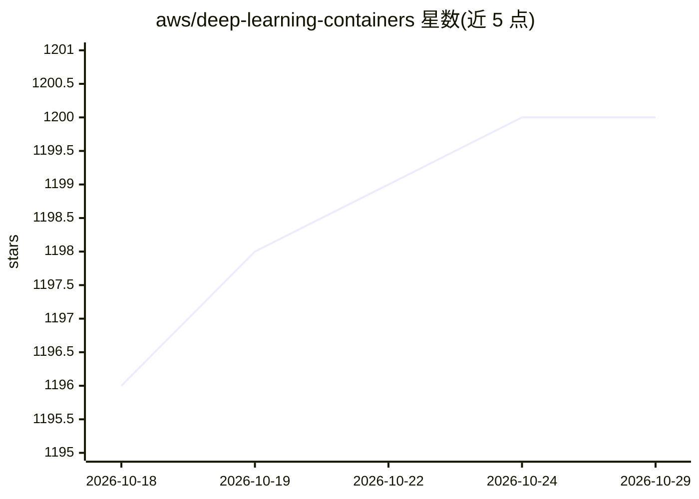

# aws/deep-learning-containers

⭐ 1,200 · Python · NOASSERTION · 推送 2026-10-28 · [GitHub](https://github.com/aws/deep-learning-containers) · [官网](https://aws.github.io/deep-learning-containers/) · 组织维护

**AWS 的深度学习预构建 Docker 镜像集合，用于运行 AI/ML 工作负载**

AWS 维护的预构建 Docker 镜像仓库，覆盖 PyTorch、TensorFlow、vLLM、vLLM-Omni、SGLang、Ray 等训练与推理框架，每个镜像经过测试与安全补丁。镜像以 EC2 与 SageMaker 两种变体发布，支持 GPU（CUDA 13.x）与 Graviton ARM64 CPU 等环境。README 指出 Ubuntu 基础的 vLLM/SGLang 镜像因缺 Ubuntu Pro 授权无法保证安全补丁，建议迁移到 Amazon Linux 镜像。面向在 AWS 上部署 AI/ML 的开发与企业用户。

## 筛选速览

| 维度 | 判定 | 备注 |
|---|---|---|
| AI 角色 | `ai-ecosystem` | LLM/agent 周边工具 |
| 许可风险 | `none` | NOASSERTION |
| 部署形态 | `None` |  |
| 模型依赖 | local-ok | 支持本地模型 |
| 硬件要求 | `cpu-ok` | |
| 安装摩擦 | `medium` | 含编译或系统依赖之一 |
| 成熟度 | — | 结构信号不足 |

## 能力要点

- 预构建并经安全测试的 PyTorch/TensorFlow/vLLM/SGLang/Ray 镜像
- 提供 EC2 与 SageMaker 两种镜像变体
- vLLM Server ARM64 CPU 版支持 Graviton 无 GPU 运行
- 定期发布版本更新与支持周期公告

## 适用场景

- 在 EC2 或 SageMaker 上部署 vLLM/SGLang 推理服务
- 在 Amazon EKS 上进行分布式训练
- 获得免手动配置 CUDA 与版本维护的预测试深度学习环境

## 场景标签

 · 领域:AI/ML 基础设施

## 证据(README 行号)

> L22: AWS Deep Learning Containers (DLCs) are pre-built Docker images for running AI/ML workloads on AWS. Each image is t
> L28: - **[2026/10/09]** vLLM v0.31.0 (Ubuntu) — EC2: `0.31.0-gpu-py312-ec2` · SageMaker: `0.31.0-gpu-py312` · DeepSeek-V

## 星数曲线

2026-10-18 1,196 → 2026-10-29 1,200（+4）

---
*卡片 v1 · prompt 1.4 · 生成 2026-10-21 · 置信度 high · 依据 README sha `917cc07e141e` · [字段定义](../../DATASET.md)*
