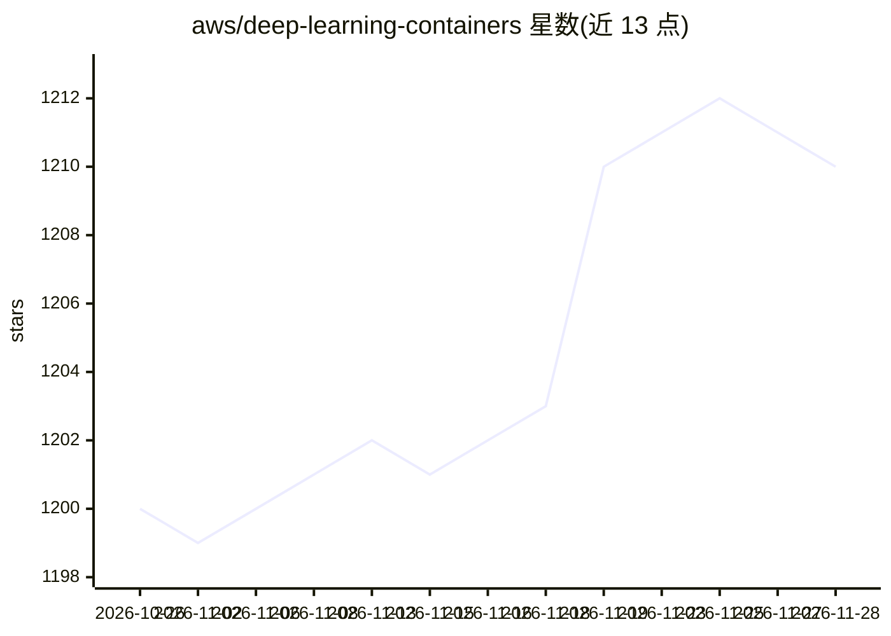

# aws/deep-learning-containers

⭐ 1,210 · Python · NOASSERTION · 推送 2026-11-27 · [GitHub](https://github.com/aws/deep-learning-containers) · [官网](https://aws.github.io/deep-learning-containers/) · 组织维护

**给 AWS 用户提供运行 AI/ML 负载的预构建 Docker 镜像**

AWS Deep Learning Containers 是一组预构建 Docker 镜像，用于在 AWS（EC2、EKS、SageMaker、Lambda 等）上运行 AI/ML 负载；每个镜像经过测试与安全漏洞修补，覆盖 PyTorch、TensorFlow 训练/推理/服务、vLLM、SGLang、Ray 等运行时，含 GPU（含 NVIDIA Blackwell sm_120）、CPU/ARM64 变体。README 提供版本发布公告、支持策略、博客与工作坊链接；安装方式为拉取镜像（Docker），本身以镜像仓库形式分发。

## 筛选速览

| 维度 | 判定 | 备注 |
|---|---|---|
| AI 角色 | `ai-ecosystem` | LLM/agent 周边工具 |
| 许可风险 | `none` | NOASSERTION |
| 部署形态 | `self-host` | docker 或自建部署 |
| 模型依赖 | local-ok | 支持本地模型 |
| 硬件要求 | — | 无带数字的原话,不猜 |
| 安装摩擦 | `low` | 无编译、无系统依赖或容器化 |
| 成熟度 | — | 结构信号不足 |

## 能力要点

- 预构建 Docker 镜像，经测试与安全漏洞修补
- 覆盖 PyTorch/TensorFlow/vLLM/SGLang/Ray/llama.cpp/WhisperX 等运行时
- 提供 EC2、SageMaker、EKS、HyperPod、Lambda 多种目标环境镜像
- 支持 GPU（含 Blackwell sm_120）与 Graviton ARM64 CPU 变体

## 适用场景

- 在 SageMaker 端点上部署 LLM 推理服务
- 在 EKS 上搭建分布式训练集群
- 用 vLLM/SGLang 镜像快速启动大模型服务
- 在 Lambda 上运行 GPU 加速函数

## 场景标签

`推理引擎` · 领域:训练与推理

## 证据(README 行号)

> L22: AWS Deep Learning Containers (DLCs) are pre-built Docker images for running AI/ML workloads on AWS. Each image is t
> L13:  Auto Release - vLLM

## 星数曲线

2026-10-26 1,200 → 2026-11-28 1,210（+10）

---
*卡片 v1 · prompt 1.4 · 生成 2026-11-26 · 置信度 high · 依据 README sha `5bee7cb77c51` · [字段定义](../../DATASET.md)*
