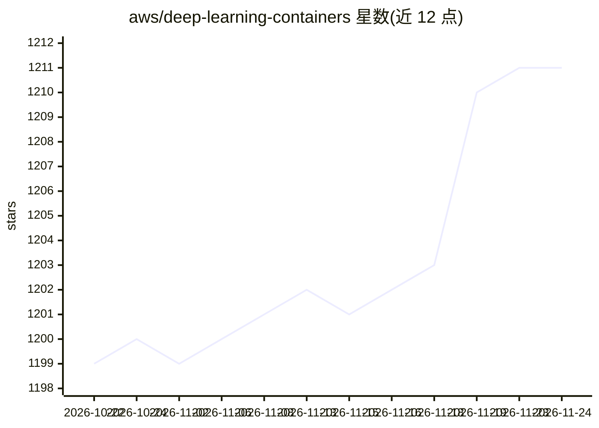

# aws/deep-learning-containers

⭐ 1,212 · Python · NOASSERTION · 推送 2026-11-23 · [GitHub](https://github.com/aws/deep-learning-containers) · [官网](https://aws.github.io/deep-learning-containers/) · 组织维护

**在 AWS 上运行 AI/ML 工作负载的预构建 Docker 镜像集**

AWS Deep Learning Containers 提供一组预先构建的 Docker 镜像，用于在 AWS（EC2、SageMaker、EKS/ECS、Lambda）上运行 AI/ML 工作负载。每张镜像经过测试并修补安全漏洞，按框架自动发布版本：覆盖 PyTorch、TensorFlow 训练/推理、vLLM、vLLM-Omni、SGLang、Ray、NVIDIA Dynamo 等运行时，区分 GPU/CPU/ARM64 变体。README 给出发布日志、支持政策（如 Ubuntu 镜像停止安全补丁、PyTorch 2.6 延长支持期限）、博客与工作坊链接；许可证为 Apache-2.0。

## 筛选速览

| 维度 | 判定 | 备注 |
|---|---|---|
| AI 角色 | `ai-ecosystem` | LLM/agent 周边工具 |
| 许可风险 | `none` | NOASSERTION |
| 部署形态 | `self-host` | docker 或自建部署 |
| 模型依赖 | local-ok | 支持本地模型 |
| 硬件要求 | — | 无带数字的原话,不猜 |
| 安装摩擦 | `low` | 无编译、无系统依赖或容器化 |
| 成熟度 | — | 结构信号不足 |

## 能力要点

- 预构建 Docker 镜像，覆盖训练、推理与 LLM 服务框架
- 自动发布流程跟踪 PyTorch/TensorFlow/vLLM/SGLang/Ray 版本
- 提供 EC2、SageMaker、EKS、Lambda 等多目标平台的镜像变体
- 镜像经测试并修补安全漏洞，附支持时间线说明

## 适用场景

- 在 SageMaker 或 EKS 上部署 vLLM/SGLang 的 LLM 推理服务
- 在 EC2 GPU 实例上运行分布式训练任务
- 用预置 CUDA 环境的镜像免去手动维护框架版本
- 在 Lambda 上运行 GPU 加速函数

## 场景标签

`推理引擎` `模型训练` · 领域:训练与推理

## 证据(README 行号)

> L5:  One stop shop for running AI/ML on AWS
> L22: AWS Deep Learning Containers (DLCs) are pre-built Docker images for running AI/ML workloads on AWS. Each image is t

## 星数曲线

2026-10-22 1,199 → 2026-11-24 1,211（+12）

---
*卡片 v1 · prompt 1.4 · 生成 2026-11-23 · 置信度 high · 依据 README sha `59e05e1b839d` · [字段定义](../../DATASET.md)*
