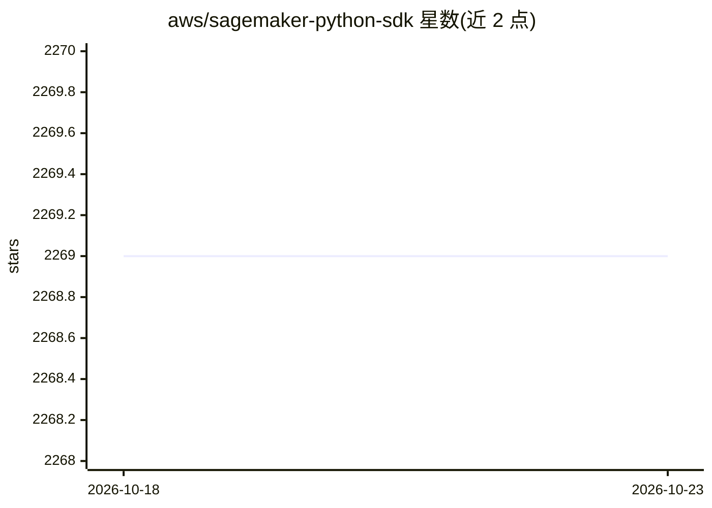

# aws/sagemaker-python-sdk

⭐ 2,269 · Python · Apache-2.0 · 推送 2026-10-22 · [GitHub](https://github.com/aws/sagemaker-python-sdk) · [官网](https://sagemaker.readthedocs.io/) · 组织维护

**AWS 官方 Python 库：在 Amazon SageMaker 上训练与部署 ML 模型**

Amazon 维护的开源 Python SDK，用于在 Amazon SageMaker 托管服务上训练和部署机器学习模型，支持 MXNet、PyTorch 等框架、Amazon 内置算法及用户自有 Docker 容器算法。V3 版本引入统一 ModelTrainer/ModelBuilder 类替代框架专属类，拆分为 core/train/serve/mlops 四个 PyPI 包；V2 的 Estimator/Model 等接口在 V3 中不再支持。SDK 内置遥测，可通过配置关闭；需要 AWS 账号与 IAM 权限，支持 Unix/Linux 与 Mac，Python 3.10–3.12。

## 筛选速览

| 维度 | 判定 | 备注 |
|---|---|---|
| AI 角色 | `ai-ecosystem` | LLM/agent 周边工具 |
| 许可风险 | `permissive` | Apache-2.0 |
| 部署形态 | `library` | 以包/库形式分发 |
| 模型依赖 | — | README 未给出锁定关系 |
| 硬件要求 | — | 无带数字的原话,不猜 |
| 安装摩擦 | `low` | 无编译、无系统依赖或容器化 |
| 成熟度 | — | 结构信号不足 |

## 能力要点

- 统一 ModelTrainer 类完成训练、ModelBuilder 类完成部署与推理
- 支持 MXNet/PyTorch 等框架、Amazon 内置算法与自定义容器
- V3 拆分为 sagemaker-core/train/serve/mlops 四个模块化 PyPI 包
- 示例覆盖分布式训练、超参调优、模型注册表与 Pipeline 等 MLOps 场景

## 适用场景

- 在 AWS 上编写 Python 脚本发起模型训练与部署
- 用统一接口管理训练、推理与 MLOps 工作流
- 把自有 Docker 容器算法接入 SageMaker 训练与托管

## 场景标签

`MLOps` `模型训练` `推理引擎` · 领域:训练与推理

## 证据(README 行号)

> L27: SageMaker Python SDK is an open source library for training and deploying machine learning models on Amazon SageMak
> L29: With the SDK, you can train and deploy models using popular deep learning frameworks **Apache MXNet** and **PyTorch
> L72: * **Unified Training & Inference**: Single classes (ModelTrainer, ModelBuilder) replace multiple framework-specific

## 星数曲线

2026-10-18 2,269 → 2026-10-23 2,269（+0）

---
*卡片 v1 · prompt 1.4 · 生成 2026-10-21 · 置信度 high · 依据 README sha `689247294d75` · [字段定义](../../DATASET.md)*
