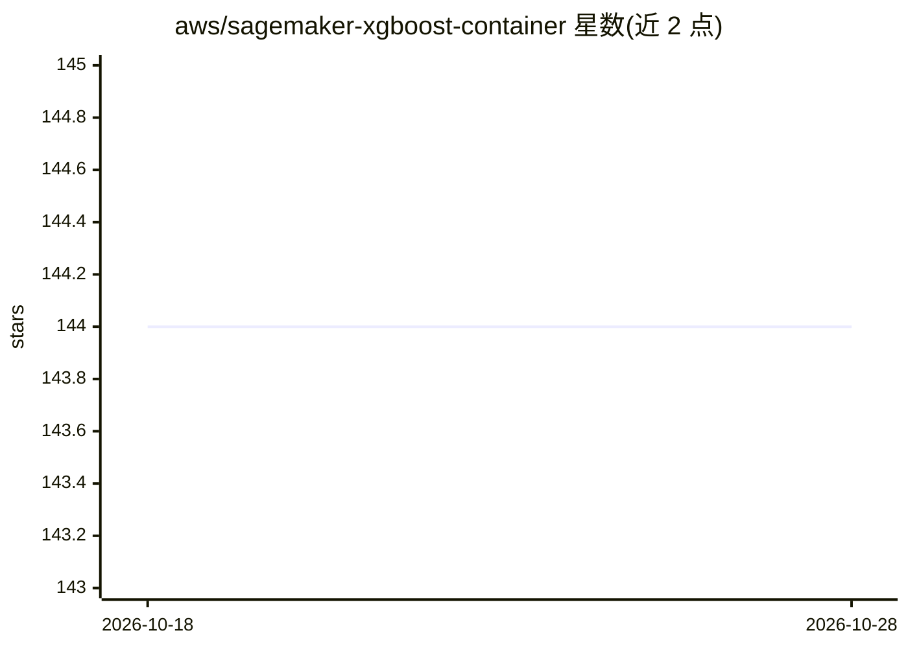

# aws/sagemaker-xgboost-container

⭐ 144 · Python · Apache-2.0 · 推送 2026-10-09 · [GitHub](https://github.com/aws/sagemaker-xgboost-container) · 组织维护

**让 XGBoost 在 Amazon SageMaker 上运行的开源容器库**

提供使 XGBoost 框架运行于 Amazon SageMaker 的开源库及配套 Dockerfile，SageMaker 团队用它构建官方 XGBoost Framework 镜像；终端用户可用于查看官方镜像实现细节或构建自定义镜像。镜像分 base 与 final 两层构建，按 XGBoost 版本、Python 版本和处理器类型分组，含单元/本地集成/SageMaker 集成测试。注意：仓库声明不再积极维护新的 XGBoost 版本升级，后续版本转移到 AWS Deep Learning Containers 仓库。

## 筛选速览

| 维度 | 判定 | 备注 |
|---|---|---|
| AI 角色 | `ai-ecosystem` | LLM/agent 周边工具 |
| 许可风险 | `permissive` | Apache-2.0 |
| 部署形态 | `self-host` | docker 或自建部署 |
| 模型依赖 | — | README 未给出锁定关系 |
| 硬件要求 | — | 无带数字的原话,不猜 |
| 安装摩擦 | `low` | 无编译、无系统依赖或容器化 |
| 成熟度 | — | 结构信号不足 |

## 能力要点

- 提供使 XGBoost 运行于 SageMaker 的开源库
- 包含 base/final 两层 Dockerfile 构建流程
- 含单元、本地集成与 SageMaker 集成测试
- 官方声明新版本维护已迁移至 deep-learning-containers 仓库

## 适用场景

- 查看 SageMaker 官方 XGBoost 镜像的实现细节
- 构建自定义的 XGBoost SageMaker 训练/推理镜像
- 为 SageMaker 上运行的 XGBoost 任务做容器定制与测试

## 场景标签

`模型训练` `推理引擎` · 领域:训练与推理

## 证据(README 行号)

> L13: SageMaker XGBoost Container is an open source library for making the
> L19: The SageMaker team uses this repository to build its official XGBoost Framework image. To use this image on SageMak

## 星数曲线

2026-10-18 144 → 2026-10-28 144（+0）

---
*卡片 v1 · prompt 1.4 · 生成 2026-10-22 · 置信度 high · 依据 README sha `baadb8fad382` · [字段定义](../../DATASET.md)*
