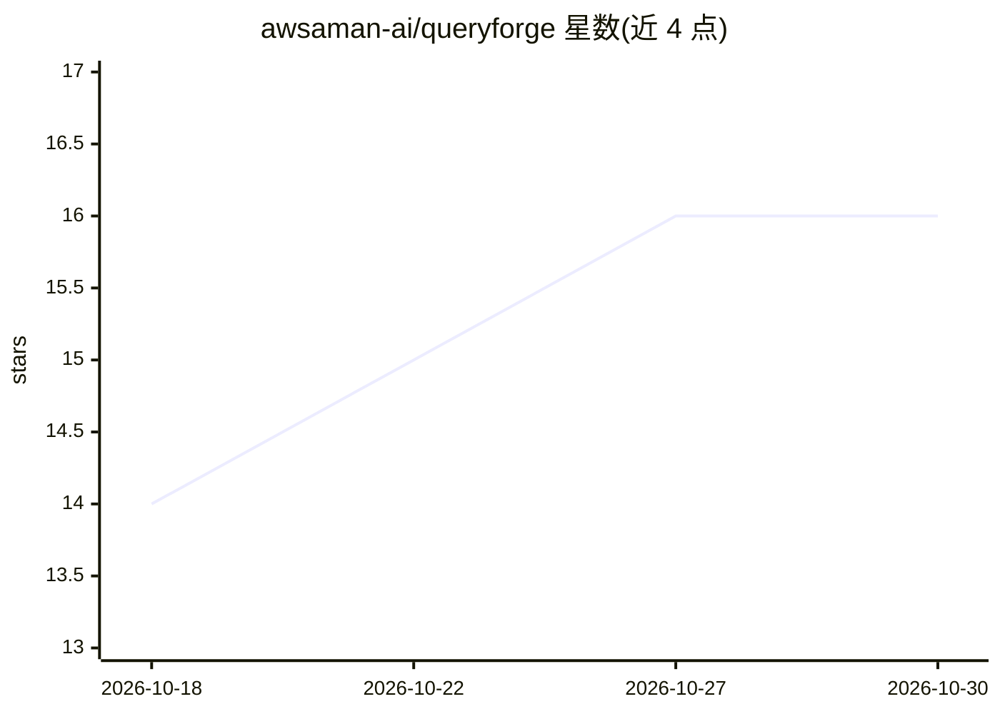

# awsaman-ai/queryforge

⭐ 16 · Go · Apache-2.0 · 推送 2026-10-25 · [GitHub](https://github.com/awsaman-ai/queryforge) · [官网](https://queryforge-service.amtry.in) · 个人维护

**自然语言转安全查询的库：LLM 填 AST，确定性编译为 SQL/Mongo 等**

面向开发者的查询构建库：用户以自然语言提问，模型只填写受配置约束的类型化 Query AST，随后由纯 Go 确定性代码编译为 PostgreSQL、MySQL、MongoDB、Elasticsearch、OpenSearch 的参数化查询。模型不接触查询字符串，AST 无变更节点，输出只读；校验器拒绝未注册字段，租户/用户级 scope 过滤在模型回答后 AND 进查询根。以 Go 库（标准库实现）、Python wheel、Java Maven 及 MCP 服务器四种形式提供，配置为单一 JSON 文件，支持多模型回退与 OpenAI 兼容、Anthropic、Bedrock 等内置端点。

## 筛选速览

| 维度 | 判定 | 备注 |
|---|---|---|
| AI 角色 | `ai-ecosystem` | LLM/agent 周边工具 |
| 许可风险 | `permissive` | Apache-2.0 |
| 部署形态 | `library` | 以包/库形式分发 |
| 模型依赖 | local-ok | 支持本地模型 |
| 硬件要求 | — | 无带数字的原话,不猜 |
| 安装摩擦 | `medium` | 含编译或系统依赖之一 |
| 成熟度 | — | 结构信号不足 |

## 能力要点

- 模型仅填写类型化 Query AST，不生成查询字符串，值全部参数化绑定
- 五种后端（Postgres/MySQL/MongoDB/Elasticsearch/OpenSearch）共用同一中间表示
- scope 过滤在模型回答后 AND 到查询根，租户字段对模型不可见
- Go 版仅依赖标准库，无第三方依赖；支持模型回退与多内置 provider

## 适用场景

- 用一句自然语言替代产品的筛选面板生成可信查询
- 多租户 SaaS 中让用户提问且强制限定租户范围
- 同一句提问跨 SQL 与 MongoDB 后端复用

## 场景标签

`数据分析` · 领域:效率与自动化

## 证据(README 行号)

> L43: Natural language  →  [ AI planner ]  →  Query AST  →  [ generators ]  →  SQL / MySQL / Mongo

## 星数曲线

2026-10-18 14 → 2026-10-30 16（+2）

---
*卡片 v1 · prompt 1.4 · 生成 2026-10-30 · 置信度 high · 依据 README sha `4b88c1ea5e35` · [字段定义](../../DATASET.md)*
