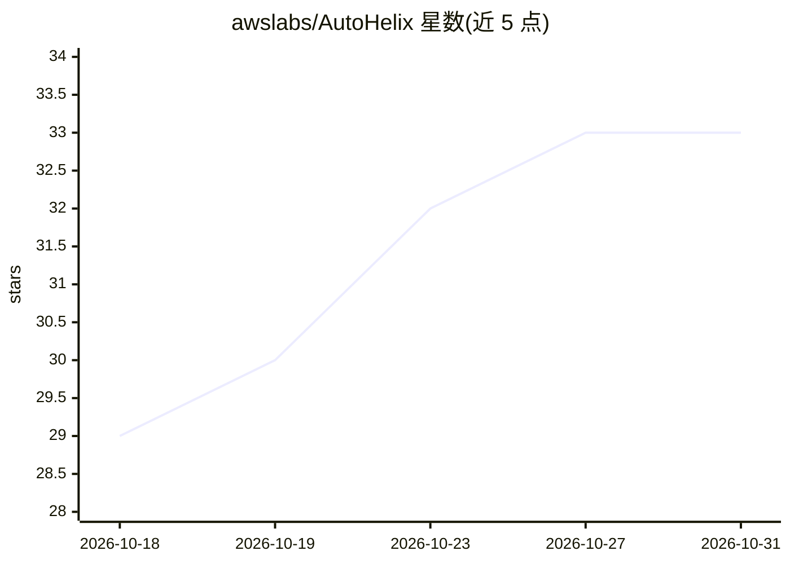

# awslabs/AutoHelix

⭐ 33 · Python · Apache-2.0 · 推送 2026-10-30 · [GitHub](https://github.com/awslabs/AutoHelix) · 组织维护

**让 AI agent 在验证回路中迭代改进代码与模型的工具**

AutoHelix 是一个轻量 harness，把 agent 放入验证改进回路：用户定义目标、约束（须通过测试/类型检查等命令）与度量指标，agent 在独立 git worktree 中提出修改，通过检查才合并，否则丢弃；支持跨迭代的持久笔记、预算控制（迭代/时间/成本）、HTML 仪表盘、LLM reviewer 与可选 Docker 沙箱。默认配合 Claude Code，也支持 Codex 与 OpenCode，面向开发者执行代码优化、模型训练等可度量任务。

## 筛选速览

| 维度 | 判定 | 备注 |
|---|---|---|
| AI 角色 | `ai-ecosystem` | LLM/agent 周边工具 |
| 许可风险 | `permissive` | Apache-2.0 |
| 部署形态 | `library` | 以包/库形式分发 |
| 模型依赖 | locked-api |  |
| 硬件要求 | — | 无带数字的原话,不猜 |
| 安装摩擦 | `low` | 无编译、无系统依赖或容器化 |
| 成熟度 | — | 结构信号不足 |

## 能力要点

- 每迭代独立 git worktree 隔离，未通过约束的尝试被干净丢弃
- 仅 editable 标记文件可改，其余冻结的 scope 强制
- 迭代/时间/成本三种维度的预算控制
- 跨迭代持久笔记与自包含 HTML 仪表盘

## 适用场景

- 让 agent 在测试与类型检查约束下迭代优化代码性能
- 用固定评测自动跑多轮模型训练/后训练实验
- 长时间无人值守地推进可度量目标并控制成本

## 场景标签

`编码 Agent` `模型训练` · 领域:编码与开发

## 证据(README 行号)

> L23: AutoHelix is a lightweight harness that lets you point an agent at a goal and leave it
> L24: looping unattended. It provides the isolation, validation, scope, and budget control to
> L63: AutoHelix uses Claude Code by default (looks for `claude` on your `PATH`). Codex and

## 星数曲线

2026-10-18 29 → 2026-10-31 33（+4）

---
*卡片 v1 · prompt 1.4 · 生成 2026-10-26 · 置信度 high · 依据 README sha `7068151ad27d` · [字段定义](../../DATASET.md)*
