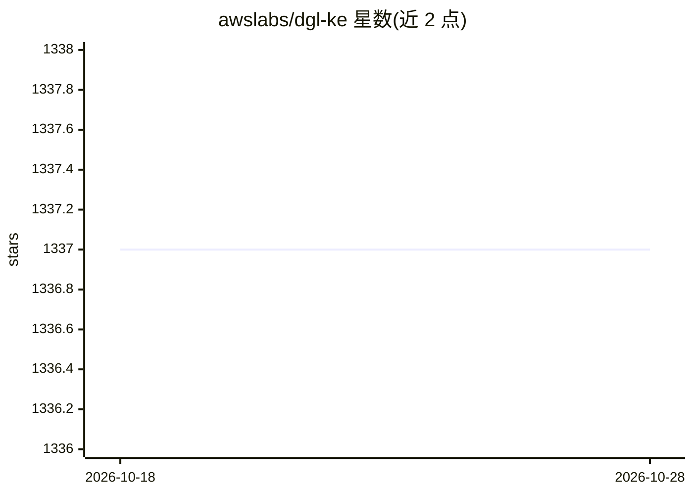

# awslabs/dgl-ke

⭐ 1,337 · Python · Apache-2.0 · 推送 2026-07-06 · [GitHub](https://github.com/awslabs/dgl-ke) · [官网](https://dglke.dgl.ai/doc/) · 组织维护

**大规模知识图谱嵌入训练工具包，供图学习开发者使用**

基于 Deep Graph Library (DGL) 构建的 Python 包，用于在大规模知识图谱上训练嵌入：支持 TransE、TransR、RESCAL、DistMult、ComplEx、RotatE 等模型，可运行于 CPU、GPU 及分布式集群环境。提供训练（dglke_train / dglke_dist_train）、评估（dglke_eval）与推理（dglke_predict / dglke_emb_sim）三类命令行任务。README 提及 8 GPU EC2 实例上 100 分钟、4 机集群 30 分钟完成含 8600 万节点图谱的基准测试。注意：README 建议仅需 TransE/DistMult/RotatE 训练的用户转用 graphstorm。

## 筛选速览

| 维度 | 判定 | 备注 |
|---|---|---|
| AI 角色 | `ai-native` | 本体是模型或模型工具 |
| 许可风险 | `permissive` | Apache-2.0 |
| 部署形态 | `library` | 以包/库形式分发 |
| 模型依赖 | — | README 未给出锁定关系 |
| 硬件要求 | — | 无带数字的原话,不猜 |
| 安装摩擦 | `low` | 无编译、无系统依赖或容器化 |
| 成熟度 | — | 结构信号不足 |

## 能力要点

- 支持 TransE/TransR/RESCAL/DistMult/ComplEx/RotatE 六类模型
- 支持 CPU、GPU 与多机分布式训练
- 提供训练/评估/推理三类命令行工具（含实体关系链接预测与嵌入相似度推理）

## 适用场景

- 在大规模知识图谱上训练嵌入用于下游机器学习任务
- 在多 GPU 或集群环境分布式训练 KG 嵌入
- 用预训练嵌入做链接预测与相似度推理

## 场景标签

`知识图谱` · 领域:知识与检索

## 证据(README 行号)

> L7: Knowledge graphs (KGs) are data structures that store information about different entities (nodes) and their relatio
> L15:  * Training, trains KG embeddings using `dglke_train`(single machine) or `dglke_dist_train`(distributed environment

## 星数曲线

2026-10-18 1,337 → 2026-10-28 1,337（+0）

---
*卡片 v1 · prompt 1.4 · 生成 2026-10-21 · 置信度 high · 依据 README sha `4c4616aa0272` · [字段定义](../../DATASET.md)*
