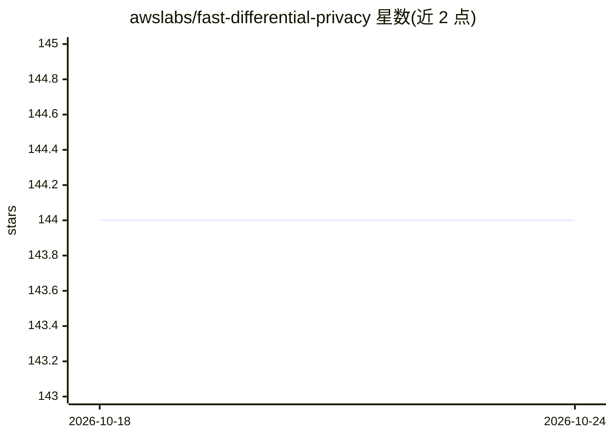

# awslabs/fast-differential-privacy

⭐ 144 · Python · Apache-2.0 · 推送 2026-01-22 · [GitHub](https://github.com/awslabs/fast-differential-privacy) · 组织维护

**面向 PyTorch 模型的差分隐私训练优化库**

fastDP 是 awslabs 维护的 Python 库，通过创建 PrivacyEngine 接入标准训练流程，对 PyTorch 模型做差分隐私优化。支持 torch.optim 全部优化器、TIMM/torchvision/HuggingFace 常见模型、RDP 与 GLW 隐私会计、多种裁剪函数，以及 DeepSpeed 和 FSDP 分布式与混合精度训练；作者声明多 GPU 场景在 512 卡 100B 模型上做过扩展性测试。采用混合幽灵范数等机制降低时间与内存开销。v2.1 发布了预训练的 DP 视觉基础模型。推荐 Python>=3.8、torch<=1.11。

## 筛选速览

| 维度 | 判定 | 备注 |
|---|---|---|
| AI 角色 | `ai-ecosystem` | LLM/agent 周边工具 |
| 许可风险 | `permissive` | Apache-2.0 |
| 部署形态 | `None` |  |
| 模型依赖 | — | README 未给出锁定关系 |
| 硬件要求 | — | 无带数字的原话,不猜 |
| 安装摩擦 | `low` | 无编译、无系统依赖或容器化 |
| 成熟度 | — | 结构信号不足 |

## 能力要点

- 以 PrivacyEngine 几行代码接入标准 PyTorch 训练流程
- 支持 DeepSpeed/FSDP 分布式与混合精度 DP 训练，作者称在 512 GPU 上测试过 100B 模型
- 支持 RDP/GLW 会计与自动裁剪（免调 max_grad_norm）
- v2.1 发布 epsilon=2/8 的 DP 预训练 ViT 基础模型

## 适用场景

- 对 BERT/RoBERTa/ViT/ResNet 等模型做差分隐私微调或全量训练
- 在大规模多 GPU 环境下进行满足隐私预算的模型训练
- 复现论文中的 DP 微调与 DP-BiTFiT 实验

## 场景标签

`微调` `模型训练` · 领域:训练与推理

## 证据(README 行号)

> L3: *Fast Differential Privacy* (**fastDP**) is a library that allows differentially private optimization of PyTorch mod
> L17: from fastDP import PrivacyEngine

## 星数曲线

2026-10-18 144 → 2026-10-24 144（+0）

---
*卡片 v1 · prompt 1.4 · 生成 2026-10-22 · 置信度 high · 依据 README sha `2d4edc08ba6e` · [字段定义](../../DATASET.md)*
