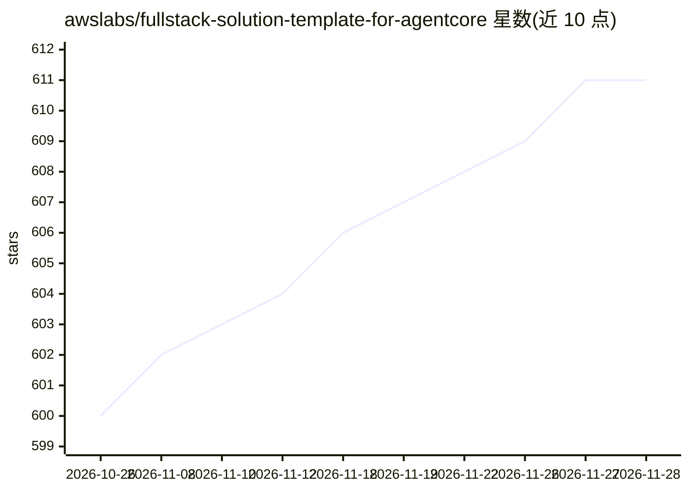

# awslabs/fullstack-solution-template-for-agentcore

⭐ 611 · Python · Apache-2.0 · 推送 2026-11-25 · [GitHub](https://github.com/awslabs/fullstack-solution-template-for-agentcore) · [官网](https://aws.amazon.com/bedrock/agentcore/) · 组织维护

**在 AWS Bedrock AgentCore 上快速部署全栈 agent 应用的模板**

面向交付科学家与工程师的 starter 项目模板，提供可 Web 访问的 React 前端与 AgentCore 后端的安全基线应用（多轮对话 agent 含 Gateway 工具与 Code Interpreter），用 CDK 或 Terraform 命令部署到 AWS。最佳实践以文档形式内置，供 AI 编码助手读取以进行 vibe-coding 式定制；对 agent SDK（Strands、LangGraph）与编码助手平台保持中立。README 注明该资产为 proof-of-value，非生产就绪方案。

## 筛选速览

| 维度 | 判定 | 备注 |
|---|---|---|
| AI 角色 | `ai-ecosystem` | LLM/agent 周边工具 |
| 许可风险 | `permissive` | Apache-2.0 |
| 部署形态 | `library` | 以包/库形式分发 |
| 模型依赖 | locked-api |  |
| 硬件要求 | — | 无带数字的原话,不猜 |
| 安装摩擦 | `low` | 无编译、无系统依赖或容器化 |
| 成熟度 | — | 结构信号不足 |

## 能力要点

- React+TypeScript 前端与 AgentCore 后端的开箱基线应用
- CDK 与 Terraform 两种基础设施部署路径
- Cognito 认证流与 Cedar 策略的细粒度访问控制
- 内置 steering 文档供 AI 编码助手参考定制

## 适用场景

- 将基于 AgentCore 的 agent 应用快速部署为全栈 Web 应用
- 以安全基线为起点定制任意用例的 AgentCore 应用
- 借助 AI 编码助手按仓库文档进行 vibe-coding 开发

## 场景标签

 · 领域:云计算/agent 应用基础设施

## 证据(README 行号)

> L5: The Fullstack AgentCore Solution Template (FAST) is a starter project repository that enables users (delivery scient
> L20: 2. **Code Interpreter** - Direct integration with Amazon Bedrock AgentCore Code Interpreter:
> L63: - **Agent Providers**: Multiple agent providers supported (Strands, LangGraph, etc.) running within AgentCore Runti

## 星数曲线

2026-10-26 600 → 2026-11-28 611（+11）

---
*卡片 v1 · prompt 1.4 · 生成 2026-11-25 · 置信度 high · 依据 README sha `088cd2d90c28` · [字段定义](../../DATASET.md)*
