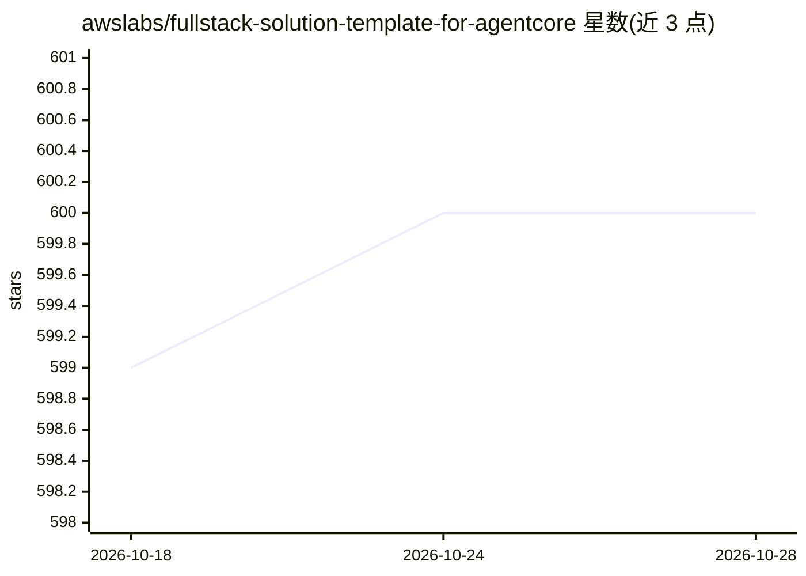

# awslabs/fullstack-solution-template-for-agentcore

⭐ 600 · Python · Apache-2.0 · 推送 2026-10-25 · [GitHub](https://github.com/awslabs/fullstack-solution-template-for-agentcore) · [官网](https://aws.amazon.com/bedrock/agentcore/) · 组织维护

**AWS 官方的 AgentCore 全栈应用部署模板**

由 awslabs 提供的入门模板仓库：包含可开箱部署的 React 前端 + AgentCore 后端全栈基线应用，内置文本分析与 Code Interpreter 工具。面向交付科学家与工程师，通过 CDK（或 Terraform）命令完成部署，覆盖 Cognito 认证、API Gateway、AgentCore Runtime 与 Gateway 的安全架构。模板不绑定特定 agent SDK（Strands、LangGraph 等）与编码助手平台，设计上供 fork 后配合 AI 编码助手定制。注意 README 声明其为 proof-of-value，非生产就绪方案。

## 筛选速览

| 维度 | 判定 | 备注 |
|---|---|---|
| AI 角色 | `ai-ecosystem` | LLM/agent 周边工具 |
| 许可风险 | `permissive` | Apache-2.0 |
| 部署形态 | `library` | 以包/库形式分发 |
| 模型依赖 | locked-api |  |
| 硬件要求 | — | 无带数字的原话,不猜 |
| 安装摩擦 | `low` | 无编译、无系统依赖或容器化 |
| 成熟度 | — | 结构信号不足 |

## 能力要点

- React + AgentCore 后端全栈基线，CDK/Terraform 一键部署
- 内置带认证的 Gateway Lambda 工具与 Code Interpreter 集成
- 与 agent SDK（Strands/LangGraph）及编码助手平台解耦
- 文档中沉淀最佳实践，配合 AI 编码助手定制开发

## 适用场景

- 快速搭建部署在 Amazon Bedrock AgentCore 上的全栈应用
- 在安全基线上定制自己的 AgentCore 应用而不必学习前端与基础设施代码
- 配合 AI 编码助手进行全栈应用开发

## 场景标签

`Agent 框架` · 领域:Agent 开发

## 证据(README 行号)

> L5: The Fullstack AgentCore Solution Template (FAST) is a starter project repository that enables users (delivery scient
> L33: Deploying the full stack out-of-the-box FAST baseline system is only a few cdk commands once you have forked the re

## 星数曲线

2026-10-18 599 → 2026-10-28 600（+1）

---
*卡片 v1 · prompt 1.4 · 生成 2026-10-21 · 置信度 high · 依据 README sha `9dd31da7dbe8` · [字段定义](../../DATASET.md)*
