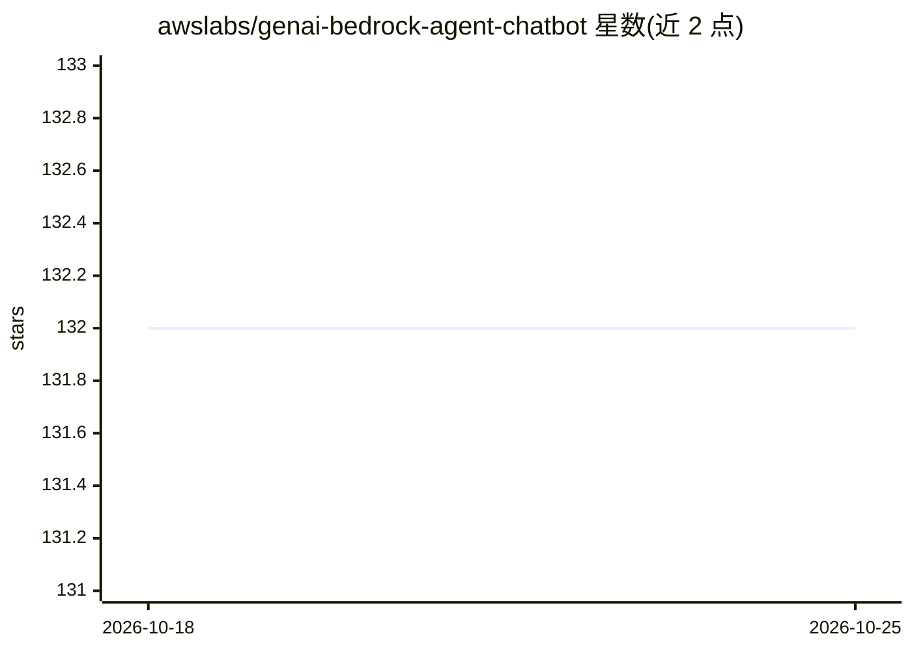

# awslabs/genai-bedrock-agent-chatbot

⭐ 132 · Python · MIT-0 · 推送 2026-09-28 · [GitHub](https://github.com/awslabs/genai-bedrock-agent-chatbot) · [官网](https://aws.amazon.com/blogs/machine-learning/automate-chatbot-for-document-and-data-retrieval-using-agents-and-knowledge-bases-for-amazon-bedrock/) · 组织维护

**基于 Amazon Bedrock 的 AWS 架构演示聊天机器人（RAG+text-to-SQL）**

AWS Labs 出品的 GenAI 聊天机器人演示应用：用 Amazon Bedrock Agent 路由两类问题——定性问题走 Bedrock KnowledgeBase 对 OpenSearch Serverless 中的文档做 RAG；定量问题经 Lambda 中 LlamaIndex 的 text-to-SQL 转成 Athena 查询 EC2 定价数据。前端为 ECS Fargate 上的 Streamlit，通过 AWS CDK 部署，需自备 AWS 账号、Docker、CDK Toolkit 与 Python 3.13+。默认模型 Claude Opus 4.8 与 Titan Embeddings V2，可替换数据源接入自有文档与表格数据。

## 筛选速览

| 维度 | 判定 | 备注 |
|---|---|---|
| AI 角色 | `ai-native` | 本体是模型或模型工具 |
| 许可风险 | `permissive` | MIT-0 |
| 部署形态 | `library` | 以包/库形式分发 |
| 模型依赖 | locked-api |  |
| 硬件要求 | — | 无带数字的原话,不猜 |
| 安装摩擦 | `low` | 无编译、无系统依赖或容器化 |
| 成熟度 | — | 结构信号不足 |

## 能力要点

- Bedrock Agent 双路径：KnowledgeBase RAG 与 LlamaIndex text-to-SQL→Athena
- AWS CDK 一键部署整套 serverless 架构（S3/Glue/Lambda/ECS/OpenSearch）
- 支持替换自有知识库文档与结构化数据（CSV/JSON/ORC/Parquet）
- 模型可切换（Claude Opus/Sonnet/Haiku、Titan Embeddings）

## 适用场景

- 学习 Bedrock Agent + KnowledgeBase 的 serverless 架构搭建
- 搭建理解自有文档和表格数据的问答机器人起点
- 演示自然语言查询结构化数据（text-to-SQL）

## 场景标签

`聊天机器人` `RAG` `数据分析` · 领域:效率与自动化

## 证据(README 行号)

> L7: This GenAI ChatBot application is built with Amazon Bedrock, including KnowledgeBase, Agent, and additional AWS serv
> L50: 1. **Qualitative questions** (e.g., "What is Amazon EC2?") → Bedrock Agent routes to KnowledgeBase → RAG over EC2 U
> L51: 2. **Quantitative questions** (e.g., "What is the cheapest EC2 instance?") → Bedrock Agent routes to Action Group →

## 星数曲线

2026-10-18 132 → 2026-10-25 132（+0）

---
*卡片 v1 · prompt 1.4 · 生成 2026-10-22 · 置信度 high · 依据 README sha `c82d825f51bd` · [字段定义](../../DATASET.md)*
