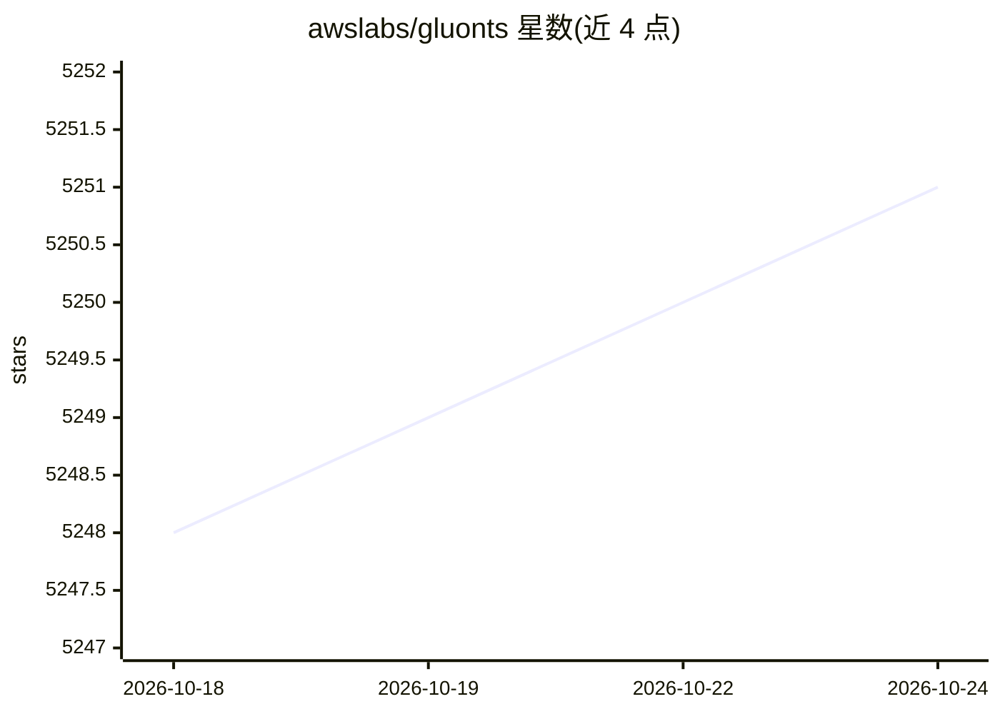

# awslabs/gluonts

⭐ 5,251 · Python · Apache-2.0 · 推送 2026-10-13 · [GitHub](https://github.com/awslabs/gluonts) · [官网](https://ts.gluon.ai) · 组织维护

**面向开发者的 Python 概率时间序列建模与预测库**

GluonTS 是基于 PyTorch 的 Python 概率时间序列建模库，提供 DeepAR 等深度学习模型的训练与预测，输出以概率分布表示的预测结果（含 50%/90% 预测区间）。面向需要时序预测的开发者与科研用户，需 Python 3.10–3.14，推荐通过 uv 或 pip 安装，torch 支持作为可选 extra（gluonts[torch]）提供。README 同步推介其 Chronos 预训练零样本预测模型系列。附 JMLR/ArXiv 论文与多个会议教程资源。

## 筛选速览

| 维度 | 判定 | 备注 |
|---|---|---|
| AI 角色 | `ai-native` | 本体是模型或模型工具 |
| 许可风险 | `permissive` | Apache-2.0 |
| 部署形态 | `library` | 以包/库形式分发 |
| 模型依赖 | — | README 未给出锁定关系 |
| 硬件要求 | — | 无带数字的原话,不猜 |
| 安装摩擦 | `low` | 无编译、无系统依赖或容器化 |
| 成熟度 | — | 结构信号不足 |

## 能力要点

- 基于 PyTorch 的概率时间序列建模库
- 输出概率分布预测，含 50% 与 90% 预测区间
- 支持 DeepAR 等深度学习模型训练与预测
- 相关 Chronos 零样本时序预测预训练模型系列

## 适用场景

- 训练 DeepAR 等模型做时间序列预测
- 获取带置信区间的概率化预测结果
- 在科研工作中做时序建模实验（附论文与教程引用）

## 场景标签

 · 领域:机器学习/时间序列预测

## 证据(README 行号)

> L11: GluonTS is a Python package for probabilistic time series modeling, focusing on deep learning based models,
> L46: To illustrate how to use GluonTS, we train a DeepAR-model and make predictions

## 星数曲线

2026-10-18 5,248 → 2026-10-24 5,251（+3）

---
*卡片 v1 · prompt 1.4 · 生成 2026-10-20 · 置信度 high · 依据 README sha `d23655825b58` · [字段定义](../../DATASET.md)*
