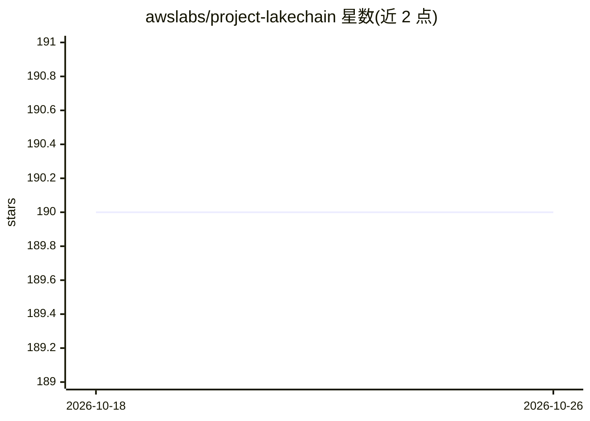

# awslabs/project-lakechain

⭐ 190 · TypeScript · Apache-2.0 · 推送 2026-09-14 · [GitHub](https://github.com/awslabs/project-lakechain) · [官网](https://awslabs.github.io/project-lakechain/) · 组织维护

**AWS 上构建可扩展文档处理管线的 CDK 框架**

基于 AWS CDK 的实验性框架，用基础设施即代码方式表达和部署可扩展的文档处理管线。提供可组合的中间件 API 与 60+ 内置中间件（README 正文称 40+ 组件），覆盖元数据提取、文档转换、NLP、摘要、翻译、音频转录、计算机视觉、RAG 等任务；支持 GPU/CPU 计算选择、自动缩放到零，另提供 50+ 示例工程。面向 AWS 客户，需部署于 AWS 云上使用。

## 筛选速览

| 维度 | 判定 | 备注 |
|---|---|---|
| AI 角色 | `ai-ecosystem` | LLM/agent 周边工具 |
| 许可风险 | `permissive` | Apache-2.0 |
| 部署形态 | `None` |  |
| 模型依赖 | local-ok | 支持本地模型 |
| 硬件要求 | — | 无带数字的原话,不猜 |
| 安装摩擦 | `low` | 无编译、无系统依赖或容器化 |
| 成熟度 | `idea` | |

## 能力要点

- 中间件组合式 API 表达文档处理管线
- 60+ 内置中间件与 50+ 示例工程
- 支持 GPU 与 CPU 计算类型选择，自动缩放到零
- 支持自定义 transform 中间件扩展

## 适用场景

- 在 AWS 上搭建 S3 上传音频的自动转录管线
- 构建可扩展的 RAG 文档处理管线
- 批量做文档转换、NLP 分析与文本摘要

## 场景标签

`RAG` `文档解析` · 领域:知识与检索

## 证据(README 行号)

> L65: Project Lakechain is an experimental framework based on the AWS Cloud Development Kit (CDK) that makes it easy to e
> L67: This project has been designed to help AWS customers build and scale different types of document processing pipelin

## 星数曲线

2026-10-18 190 → 2026-10-26 190（+0）

---
*卡片 v1 · prompt 1.4 · 生成 2026-10-22 · 置信度 high · 依据 README sha `81d805ce53b1` · [字段定义](../../DATASET.md)*
