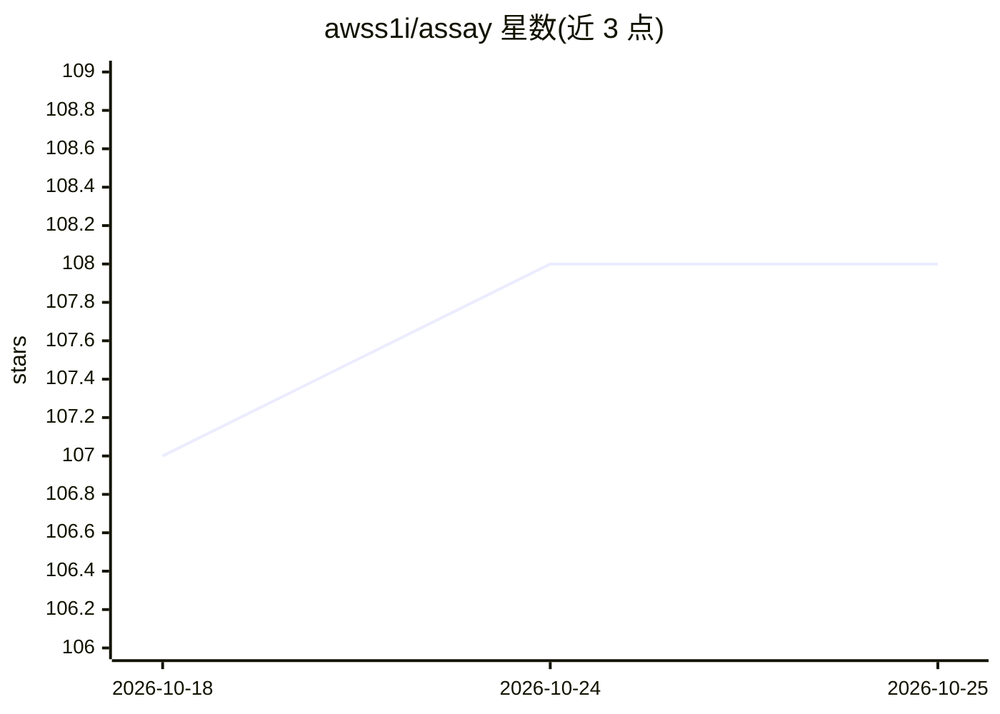

# awss1i/assay

⭐ 108 · Python · MIT · 推送 2026-10-19 · [GitHub](https://github.com/awss1i/assay) · [官网](https://pypi.org/project/assay-ui/) · 个人维护 · 中文 README

**面向编码 agent 的网页确定性 QA CLI：自动发现控件并检查**

assay 是一个用 pip 安装的 Python 命令行工具：在 Chromium 中打开本地网页，枚举页面上所有控件（含可点击 div、拖拽柄、可编辑区域），自动生成并执行检查（按按钮、输入各类文本、切换下拉、提交表单等），对比操作前后页面状态并报告自相矛盾之处（报错、Undo 首按无效、计数与列表不符、出现 NaN 等）。不使用 LLM、无需 API key，结果确定可复现；重复触发的同一缺陷会归并为同一 finding。提供 skill（15 种编码 agent 框架）与 plugin hook（7 种框架自动在每轮后运行）。限制：无法检查业务意图、一次只检查一页、不执行构建、耗时数秒到一分钟。

## 筛选速览

| 维度 | 判定 | 备注 |
|---|---|---|
| AI 角色 | `ai-ecosystem` | LLM/agent 周边工具 |
| 许可风险 | `permissive` | MIT |
| 部署形态 | `library` | 以包/库形式分发 |
| 模型依赖 | — | README 未给出锁定关系 |
| 硬件要求 | — | 无带数字的原话,不猜 |
| 安装摩擦 | `low` | 无编译、无系统依赖或容器化 |
| 成熟度 | — | 结构信号不足 |

## 能力要点

- 从页面控件自动生成检查，无需编写测试，也不使用 LLM
- skill 支持 15 种编码 agent 框架，plugin hook 在 7 种框架中每轮自动运行
- 同一缺陷触发多个检查时归并为同一 finding
- 输出 HTML 报告（含截图）与 --one-line 短摘要，退出码非零表示有失败

## 适用场景

- 让编码 agent 写完页面后自动检查其行为
- 无需编写测试脚本就对静态构建产物做快速 QA
- 在 CI 或脚本中用退出码判断页面是否有问题

## 场景标签

`浏览器自动化` · 领域:效率与自动化

## 证据(README 行号)

> L12:  An agent-native QA CLI for web pages. Deterministic, no tests to write, no LLM.
> L30: - **Works with coding agents.** A skill, supported across fifteen harnesses,

## 星数曲线

2026-10-18 107 → 2026-10-25 108（+1）

---
*卡片 v1 · prompt 1.4 · 生成 2026-10-23 · 置信度 mid · 依据 README sha `c6c1bf5c0370` · [字段定义](../../DATASET.md)*
