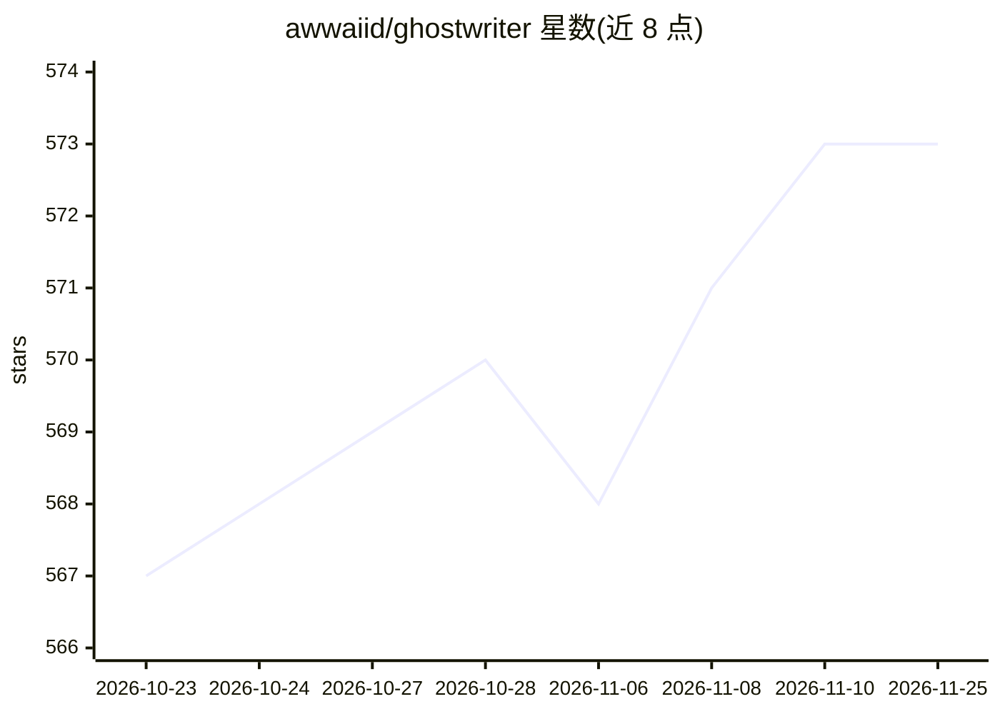

# awwaiid/ghostwriter

⭐ 573 · Rust · MIT · 推送 2026-11-12 · [GitHub](https://github.com/awwaiid/ghostwriter) · 个人维护

**把 reMarkable2 电纸书变成视觉大模型的书写交互界面**

运行在 reMarkable2 平板上的 Rust 程序：读取用户的手写内容与屏幕截图，提交给视觉大模型（OpenAI/Anthropic/Google 引擎，默认 claude-sonnet-4-6），模型返回的文字通过虚拟键盘写出、SVG 通过光标绘制回屏幕；用手指点击指定角落触发请求。支持 CLI 参数、~/.ghostwriter.toml 配置文件与环境变量三层配置，可选图像分割增强空间感知、流式绘制、web 搜索与 thinking。官方提供 reMarkable2 预编译二进制，通过 wget 下载后 SSH 到设备运行；开发者可交叉编译支持 rmpp（Paper Pro）。

## 筛选速览

| 维度 | 判定 | 备注 |
|---|---|---|
| AI 角色 | `ai-native` | 本体是模型或模型工具 |
| 许可风险 | `permissive` | MIT |
| 部署形态 | `library` | 以包/库形式分发 |
| 模型依赖 | local-ok | 支持本地模型 |
| 硬件要求 | — | 无带数字的原话,不猜 |
| 安装摩擦 | `medium` | 含编译或系统依赖之一 |
| 成熟度 | `idea` | |

## 能力要点

- 手写输入+触屏角落手势触发，模型以打字或绘图方式写回屏幕
- 支持 openai/anthropic/google 三种引擎，可自定义 API base URL
- 提供 draw_text/draw_svg 工具调用与 --apply-segmentation 图像分割
- CLI/配置文件/环境变量统一配置，支持 nohup 后台运行

## 适用场景

- 在 reMarkable 上手写数学题让模型补全答案并写在指定位置
- 手写提示词让模型直接在纸上画线稿图
- 把电纸书作为与视觉大模型交互的实验性界面做交互探索

## 场景标签

`AI 助手` · 领域:对话与助手

## 证据(README 行号)

> L2: > An experiment for the reMarkable that watches what you write and, when prompted either with a gesture or some on-s
> L52: * `--engine ENGINE` - Engine: openai, anthropic, google (auto-detected from model)
> L121:  * `scp target/armv7-unknown-linux-gnueabihf/release/ghostwriter root@remarkable:`

## 星数曲线

2026-10-23 567 → 2026-11-25 573（+6）

---
*卡片 v1 · prompt 1.4 · 生成 2026-11-25 · 置信度 high · 依据 README sha `0a64124cbd87` · [字段定义](../../DATASET.md)*
