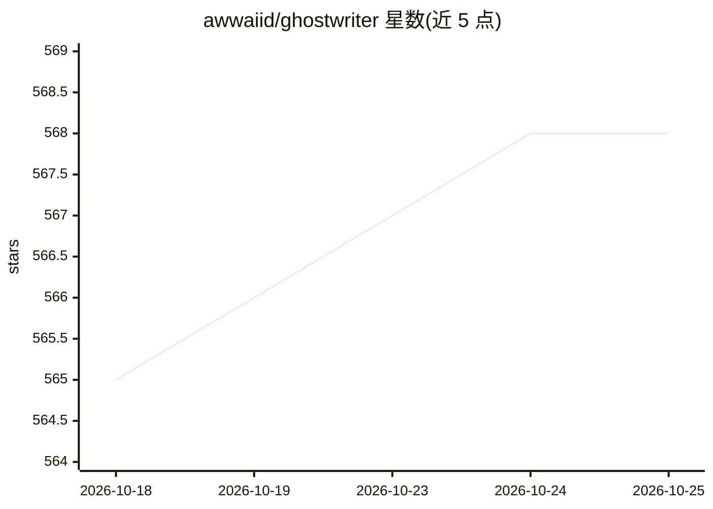

# awwaiid/ghostwriter

⭐ 568 · Rust · MIT · 推送 2026-07-10 · [GitHub](https://github.com/awwaiid/ghostwriter) · 个人维护

**让 reMarkable2 电子墨水屏直连视觉 LLM 的手写交互实验程序**

在 reMarkable2 墨水屏设备上运行的 Rust 程序：截取屏幕手写内容发送给视觉 LLM（OpenAI/Anthropic/Google 引擎，默认 claude-sonnet-4-0），模型通过 draw_text 与 draw_svg 工具以打字文本或 SVG 线条画形式回写到屏幕；用户以触碰屏幕角落手势触发。可选图像分割预处理增强空间感知，支持自定义 API base URL（如 Groq）。定位为作者个人的交互探索实验，README 以开发日志形式记录，包含大量未完成 TODO。以预编译二进制发布，SSH 到设备运行；开发需 Docker 交叉编译。

## 筛选速览

| 维度 | 判定 | 备注 |
|---|---|---|
| AI 角色 | `ai-native` | 本体是模型或模型工具 |
| 许可风险 | `permissive` | MIT |
| 部署形态 | `library` | 以包/库形式分发 |
| 模型依赖 | locked-api |  |
| 硬件要求 | — | 无带数字的原话,不猜 |
| 安装摩擦 | `medium` | 含编译或系统依赖之一 |
| 成熟度 | `idea` | |

## 能力要点

- 手写输入→视觉 LLM→以文本/SVG 绘制回写墨水屏的闭环交互
- 支持 openai/anthropic/google 三种引擎与自定义 base URL（如 Groq）
- 可选图像分割预处理（--apply-segmentation）提供空间感知
- 虚拟键盘 text-assist 模式以打字文本回复

## 适用场景

- 在 reMarkable 上手写数学题让 AI 补全答案
- 手写提示词让模型在墨水屏上画简笔画（SVG）
- 探索墨水屏+手写+LLM 的交互形态并自建评估流程

## 场景标签

`多模态` `AI 助手` · 领域:对话与助手

## 证据(README 行号)

> L2: > An experiment for the reMarkable that watches what you write and, when prompted either with a gesture or some on-s
> L51: * `--model MODEL` - Model to use (default: claude-sonnet-4-0)

## 星数曲线

2026-10-18 565 → 2026-10-25 568（+3）

---
*卡片 v1 · prompt 1.4 · 生成 2026-10-22 · 置信度 high · 依据 README sha `e6359dd19809` · [字段定义](../../DATASET.md)*
