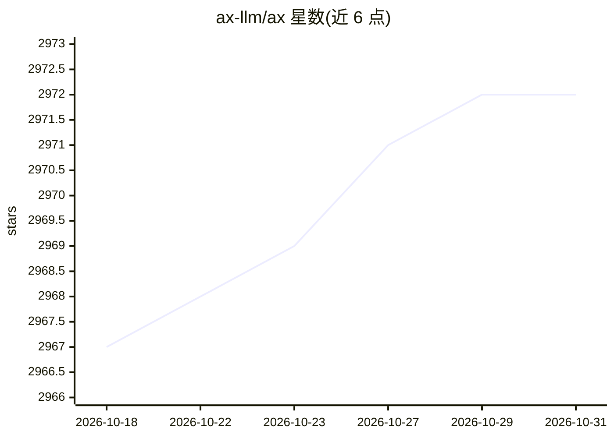

# ax-llm/ax

⭐ 2,972 · TypeScript · Apache-2.0 · 推送 2026-10-29 · [GitHub](https://github.com/ax-llm/ax) · [官网](http://axllm.dev) · 个人维护

**TypeScript 优先的 DSPy 式 LLM 编程框架，多语言生成移植**

面向 LLM 应用开发者的 DSPy 风格框架：以签名（Signature）声明式定义输入输出类型与约束，配合 AI 客户端做结构化生成、校验、重试、流式解析；提供带沙箱 JS 运行时、记忆、技能与上下文映射的 Agent 三段式流水线、类型化流程图与 GEPA 等优化器。TypeScript 为源实现并发布于 npm，同一语义核心编译生成 Python、Java、C++、Go、Rust 库。支持 OpenAI/Anthropic/Gemini/Grok/DeepSeek/Together 等多家 provider 部署配置，含音频与实时流路径。

## 筛选速览

| 维度 | 判定 | 备注 |
|---|---|---|
| AI 角色 | `ai-ecosystem` | LLM/agent 周边工具 |
| 许可风险 | `permissive` | Apache-2.0 |
| 部署形态 | `library` | 以包/库形式分发 |
| 模型依赖 | locked-api |  |
| 硬件要求 | — | 无带数字的原话,不猜 |
| 安装摩擦 | `medium` | 含编译或系统依赖之一 |
| 成熟度 | — | 结构信号不足 |

## 能力要点

- 签名 DSL / f() 构建器 / Standard Schema v1 三种输入方式做结构化生成
- AxAgent 三段式流水线（distiller→executor→responder）与递归运行时（RLM）沙箱执行
- 同一语义核心编译为 TypeScript/Python/Java/C++/Go/Rust 六种语言库
- 多 provider 部署配置（openai/anthropic/google-gemini/deepseek/grok/together 等）

## 适用场景

- 用签名声明式地构建带校验与重试的结构化输出
- 构建长上下文、带工具调用的 Agent（记忆、技能、沙箱运行时）
- 在多语言技术栈间复用同一套 LLM 程序模型

## 场景标签

`Agent 框架` · 领域:Agent 开发

## 证据(README 行号)

> L6: Ax is TypeScript-first and ships today as `@ax-llm/ax`. The same signatures,
> L30: - **Optimizers** including GEPA, few-shot bootstrapping, portable optimizer
> L98: Ax is designed to stay in the same latency class as direct provider calls while adding typed outputs, validation, r

## 星数曲线

2026-10-18 2,967 → 2026-10-31 2,972（+5）

---
*卡片 v1 · prompt 1.4 · 生成 2026-10-20 · 置信度 high · 依据 README sha `568bf717f716` · [字段定义](../../DATASET.md)*
