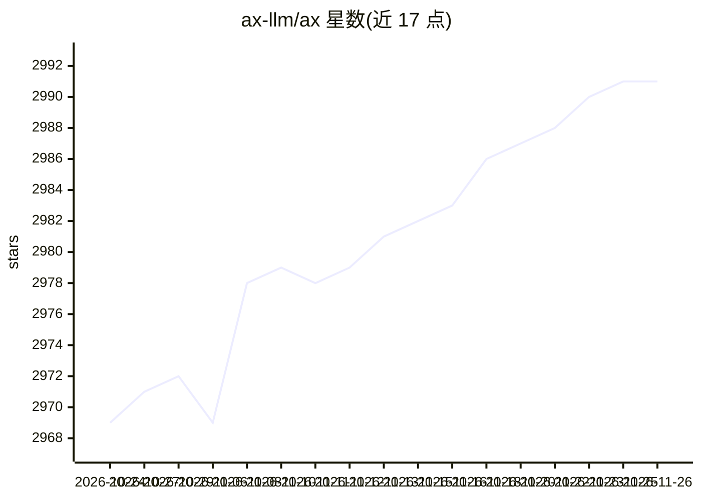

# ax-llm/ax

⭐ 2,991 · TypeScript · Apache-2.0 · 推送 2026-11-20 · [GitHub](https://github.com/ax-llm/ax) · [官网](http://axllm.dev) · 个人维护

**TypeScript 优先的 DSPy 编程模型，跨多语言构建 LLM 应用**

Ax 提供 typed signatures、agents、flows 与 optimizers 等编程构件，用于以结构化签名方式调用 LLM，无需手写提示词。同一编程模型编译生成 Python、Java、C++、Go、Rust 库，跨语言暴露相同 API。支持多 provider 部署档案切换、流式输出、ReAct 工具调用、多模态与音频（含 realtime 语音）、三阶段 AxAgent 与沙箱 JS 运行时。主要发布形态为 npm 包 @ax-llm/ax，其余语言包发布于 PyPI、Maven Central、crates.io。

## 筛选速览

| 维度 | 判定 | 备注 |
|---|---|---|
| AI 角色 | `ai-ecosystem` | LLM/agent 周边工具 |
| 许可风险 | `permissive` | Apache-2.0 |
| 部署形态 | `library` | 以包/库形式分发 |
| 模型依赖 | locked-api |  |
| 硬件要求 | — | 无带数字的原话,不猜 |
| 安装摩擦 | `medium` | 含编译或系统依赖之一 |
| 成熟度 | — | 结构信号不足 |

## 能力要点

- 签名式结构化生成：字符串 DSL、f() builder、兼容 Zod/Valibot/ArkType（Standard Schema v1）
- 同一编程模型编译生成 Python/Java/C++/Go/Rust 五个语言库
- Agent 支持上下文预算、checkpoint 回放、记忆（vector/BM25/KV）与 skills 按需加载
- 流式默认：边解析边校验、流式断言与早期失败纠正

## 适用场景

- 用 TypeScript 构建结构化抽取或分类的 LLM 流水线
- 构建带工具调用、记忆与技能的长期运行 Agent
- 在多语言技术栈中复用同一套 LLM 编程模型
- 接入语音转录/合成与 realtime 语音对话

## 场景标签

`Agent 框架` `提示工程` · 领域:Agent 开发

## 证据(README 行号)

> L21: - **Signatures** for typed structured generation: string DSL, fluent `f()`
> L26: - **Agents** with runtime execution, context budgets, checkpoints, action-log
> L62: const llm = ai({ name: "openai", apiKey: process.env.OPENAI_APIKEY });

## 星数曲线

2026-10-24 2,969 → 2026-11-26 2,991（+22）

---
*卡片 v1 · prompt 1.4 · 生成 2026-11-23 · 置信度 high · 依据 README sha `32682e9c133b` · [字段定义](../../DATASET.md)*
