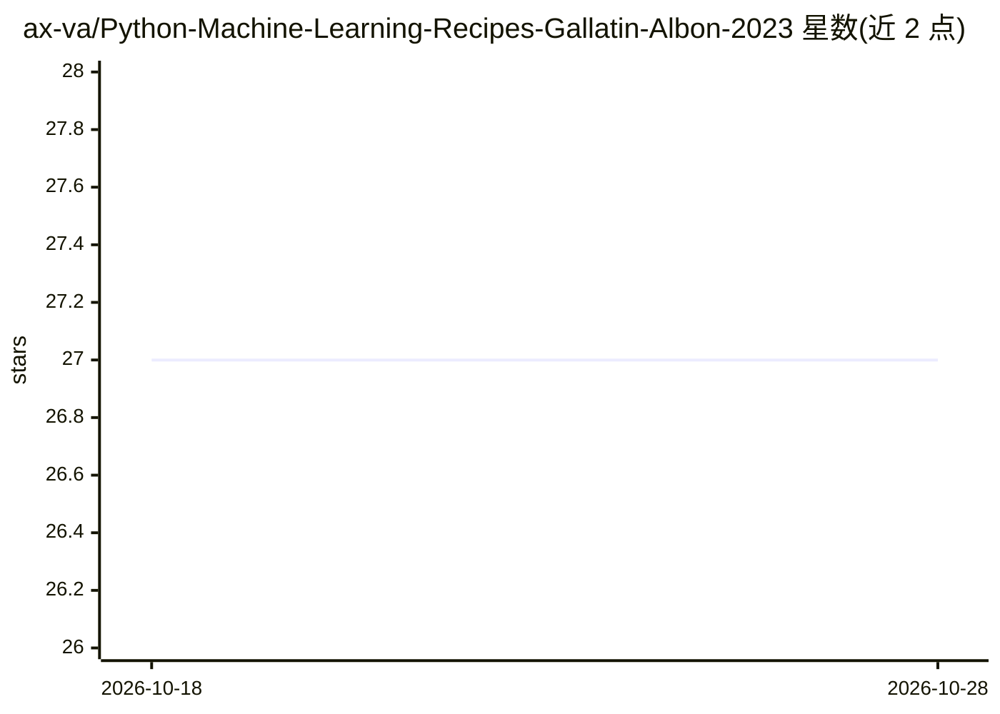

# ax-va/Python-Machine-Learning-Recipes-Gallatin-Albon-2023

⭐ 27 · Python · 推送 2026-08-21 · [GitHub](https://github.com/ax-va/Python-Machine-Learning-Recipes-Gallatin-Albon-2023) · 个人维护

**《Machine Learning with Python Cookbook》第二版代码配方集**

基于 O'Reilly 出版的《Machine Learning with Python Cookbook: Practical Solutions from Preprocessing to Deep Learning》第二版（Kyle Gallatin 与 Chris Albon 著，2023）整理的 Python 机器学习配方代码仓库，覆盖经典机器学习与神经网络，使用 scikit-learn、OpenCV、PyTorch 等库。环境为 Python 3.11，依赖见 requirements.txt。以书籍配套代码形式提供。

## 筛选速览

| 维度 | 判定 | 备注 |
|---|---|---|
| AI 角色 | `ai-knowledge` | 知识聚合/清单类 |
| 许可风险 | `none` | — |
| 部署形态 | `None` |  |
| 模型依赖 | — | README 未给出锁定关系 |
| 硬件要求 | — | 无带数字的原话,不猜 |
| 安装摩擦 | `low` | 无编译、无系统依赖或容器化 |
| 成熟度 | — | 结构信号不足 |

## 能力要点

- 书籍配套的机器学习配方代码集
- 覆盖经典机器学习与神经网络
- 使用 scikit-learn、OpenCV、PyTorch 等库

## 适用场景

- 学习书中的机器学习配方并对照代码练习
- 查找预处理到深度学习各环节的示例实现

## 场景标签

`教程课程` · 领域:学习与行业

## 证据(README 行号)

> L1: # Machine Learning Recipes in Python
> L3: Machine learning recipes in Python with **scikit-learn**, **OpenCV**, **PyTorch**, and other libraries, including cl

## 星数曲线

2026-10-18 27 → 2026-10-28 27（+0）

---
*卡片 v1 · prompt 1.4 · 生成 2026-10-26 · 置信度 mid · 依据 README sha `94a876afa257` · [字段定义](../../DATASET.md)*
