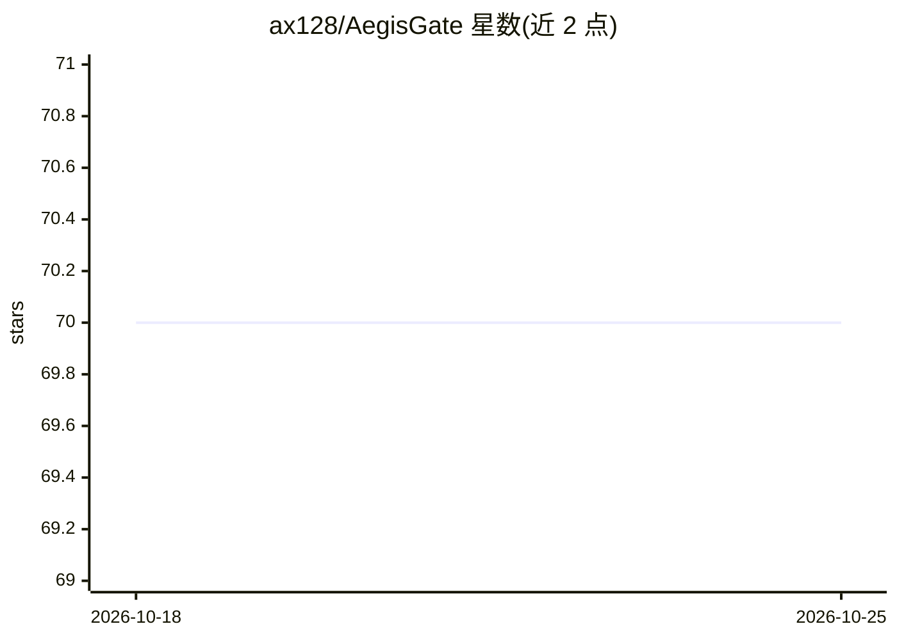

# ax128/AegisGate

⭐ 70 · Python · MIT · 推送 2026-09-14 · [GitHub](https://github.com/ax128/AegisGate) · [官网](https://github.com/ax128/AegisGate) · 个人维护 · 中文 README

**自托管的 LLM API 安全网关：PII 脱敏与提示注入防护代理**

自托管、流水线式的安全代理，部署在 AI 应用/Agent 与上游 LLM 提供方之间：将应用的 baseUrl 指向网关后，自动对请求与响应执行 PII/密钥脱敏（50+ 模式类别）、多层提示注入检测（正则+可选语义审查+Unicode 编码攻击检测）、危险输出净化（shell 命令、SQL 注入等按风险分放行/净化/阻断）与审计日志。提供 OpenAI 兼容路由与 Anthropic Messages API 及两者协议转换，支持 MCP 集成 Cursor/Claude Code/Codex 等 AI 编码 Agent，内置 Web 管理控制台，Docker Compose 部署，存储支持 SQLite/Redis/PostgreSQL。基线检测全部本地运行，语义审查为可选外部服务。

## 筛选速览

| 维度 | 判定 | 备注 |
|---|---|---|
| AI 角色 | `ai-ecosystem` | LLM/agent 周边工具 |
| 许可风险 | `permissive` | MIT |
| 部署形态 | `self-host` | docker 或自建部署 |
| 模型依赖 | locked-api |  |
| 硬件要求 | — | 无带数字的原话,不猜 |
| 安装摩擦 | `low` | 无编译、无系统依赖或容器化 |
| 成熟度 | — | 结构信号不足 |

## 能力要点

- 请求+响应双向过滤：PII 脱敏、提示注入检测、危险命令净化
- 50+ PII 模式类别，结构化对话路由默认运行 13 项凭证类子集
- OpenAI 兼容路由 + Anthropic↔OpenAI 协议实时转换
- MCP/Agent SKILL 集成与 Web 管理控制台，基线检测无外部 API 依赖

## 适用场景

- 防止 API 密钥、内部 URL 等敏感数据泄漏给 LLM 提供方
- 为 Cursor/Claude Code/Codex 等编码 Agent 的 LLM 流量统一加安全策略
- 集中审计 LLM 交互并拦截提示注入与危险输出

## 场景标签

`网络安全` `模型网关` · 领域:Agent 开发

## 证据(README 行号)

> L5: **Open-source security gateway for LLM API calls** — sits between your AI agents/apps and upstream LLM providers, en
> L9: AegisGate is a self-hosted, pipeline-based security proxy designed to protect LLM API traffic. Point your applicatio
> L61: AegisGate is an open-source, self-hosted security gateway that sits between your AI applications and LLM API provid

## 星数曲线

2026-10-18 70 → 2026-10-25 70（+0）

---
*卡片 v1 · prompt 1.4 · 生成 2026-10-24 · 置信度 mid · 依据 README sha `0b09a69802f0` · [字段定义](../../DATASET.md)*
