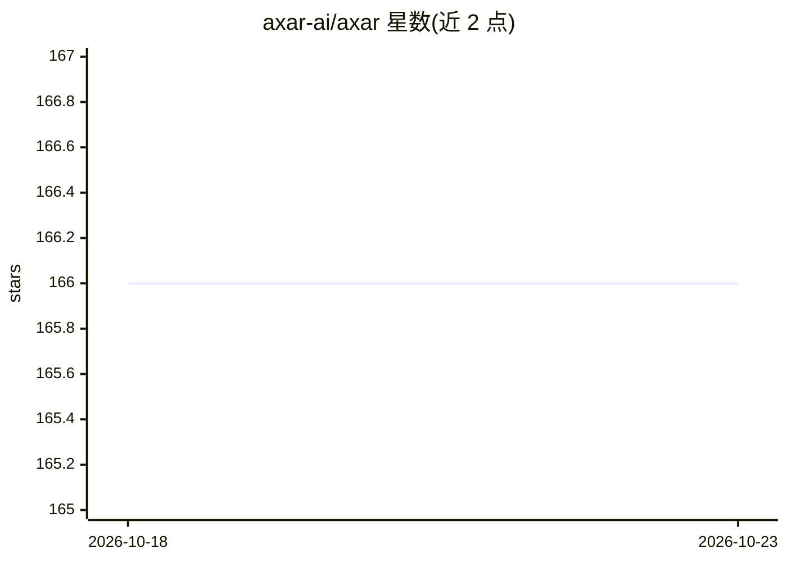

# axar-ai/axar

⭐ 166 · TypeScript · Apache-2.0 · 推送 2026-02-09 · [GitHub](https://github.com/axar-ai/axar) · [官网](https://axar.ai) · 组织维护

**面向 TypeScript 开发者的极简 agent 框架**

用 TypeScript 构建生产级 LLM agent 应用的框架：以代码为中心，通过装饰器（@model/@schema）、依赖注入定义 agent、系统提示、结构化输入输出与工具调用；提供流式输出、内置校验与实时日志监控。模型无关，支持 OpenAI、Anthropic、Gemini 等并可扩展。通过 npm 安装，目前要求 ts-node 运行（tsx 尚不支持实验性装饰器），项目自述处于早期 alpha 阶段。

## 筛选速览

| 维度 | 判定 | 备注 |
|---|---|---|
| AI 角色 | `ai-ecosystem` | LLM/agent 周边工具 |
| 许可风险 | `permissive` | Apache-2.0 |
| 部署形态 | `library` | 以包/库形式分发 |
| 模型依赖 | — | README 未给出锁定关系 |
| 硬件要求 | — | 无带数字的原话,不猜 |
| 安装摩擦 | `low` | 无编译、无系统依赖或容器化 |
| 成熟度 | `idea` | |

## 能力要点

- 装饰器与依赖注入方式定义 agent 与结构化输入输出
- 模型无关，支持 OpenAI/Anthropic/Gemini 并可扩展
- 流式输出带内置校验
- 实时日志与监控工具

## 适用场景

- 用熟悉的 TypeScript 编码方式构建 LLM agent 应用
- 在代码中显式定义 agent 行为、guardrails 与校验
- 为现有 Node.js 项目集成轻量 agent 能力

## 场景标签

`Agent 框架` · 领域:Agent 开发

## 证据(README 行号)

> L10: **AXAR AI** is a lightweight framework for building production-ready agentic applications using TypeScript. It’s de
> L43: - **🌐 Model agnostic**: Works with OpenAI, Anthropic, Gemini, and more, with easy extensibility for additional mode

## 星数曲线

2026-10-18 166 → 2026-10-23 166（+0）

---
*卡片 v1 · prompt 1.4 · 生成 2026-10-22 · 置信度 high · 依据 README sha `0217d7116a6d` · [字段定义](../../DATASET.md)*
