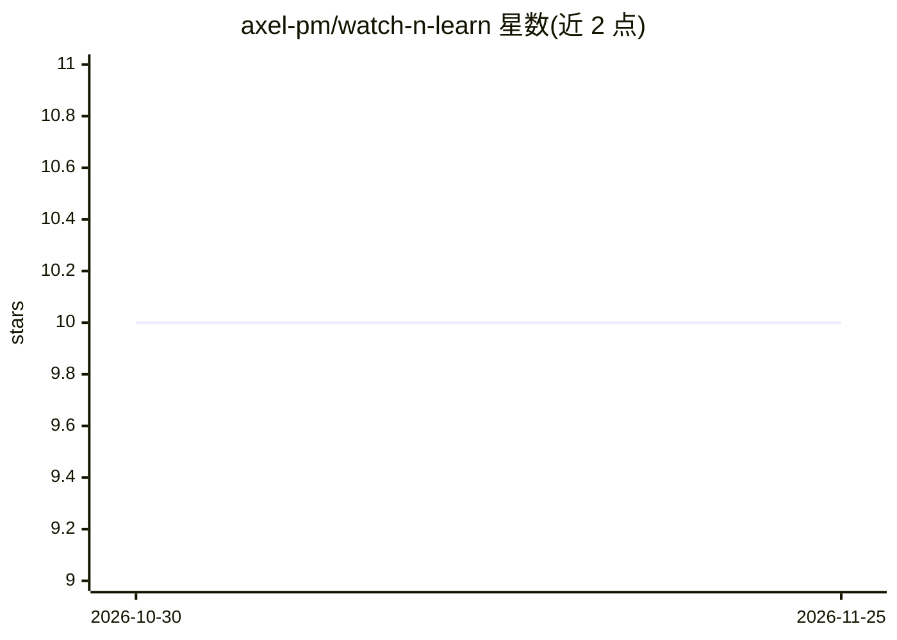

# axel-pm/watch-n-learn

⭐ 10 · Python · MIT · 推送 2026-10-21 · [GitHub](https://github.com/axel-pm/watch-n-learn) · 个人维护

**把教学视频转成 AI 编码助手可复用技能的本地工具**

面向 AI 编码助手用户的本地工具：指向一个 how-to 视频，经五步本地流程生成 SKILL.md 技能文件夹——先判断视频是否含可复用流程，再抽帧（PyAV）并离线转写音频（faster-whisper），拆解步骤、写入技能并在真实测试任务上验证修正。全程本地运行，无账号、无 API key；支持 --transcript-only / --frames-only 模式。通过 Claude Code 插件市场安装，技能格式兼容多个编码 agent，首次运行需联网拉取视频工具。MIT 许可。

## 筛选速览

| 维度 | 判定 | 备注 |
|---|---|---|
| AI 角色 | `ai-native` | 本体是模型或模型工具 |
| 许可风险 | `permissive` | MIT |
| 部署形态 | `None` |  |
| 模型依赖 | — | README 未给出锁定关系 |
| 硬件要求 | — | 无带数字的原话,不猜 |
| 安装摩擦 | `low` | 无编译、无系统依赖或容器化 |
| 成熟度 | — | 结构信号不足 |

## 能力要点

- 五步本地流程生成 SKILL.md 技能并实际运行验证
- PyAV 抽帧 + faster-whisper 离线转写，无 API key
- 支持纯转写或纯画面两种观看模式
- 通过 Claude Code 插件市场一条命令安装

## 适用场景

- 把教程视频固化成 agent 可执行的技能，避免反复回看
- 将会议演讲内容转成编码助手可自动触发的技能
- 对本地视频文件做完全离线的技能提取

## 场景标签

`编码 Agent` · 领域:编码与开发

## 证据(README 行号)

> L5: **Point it at a how-to video. It writes a reusable skill for your AI coding assistant, one it can follow later witho
> L24: 2. Watch. It pulls a handful of still frames out of the video and transcribes the audio, so it can "see" and "hear"

## 星数曲线

2026-10-30 10 → 2026-11-25 10（+0）

---
*卡片 v1 · prompt 1.4 · 生成 2026-11-22 · 置信度 high · 依据 README sha `6eaaecb3b86e` · [字段定义](../../DATASET.md)*
