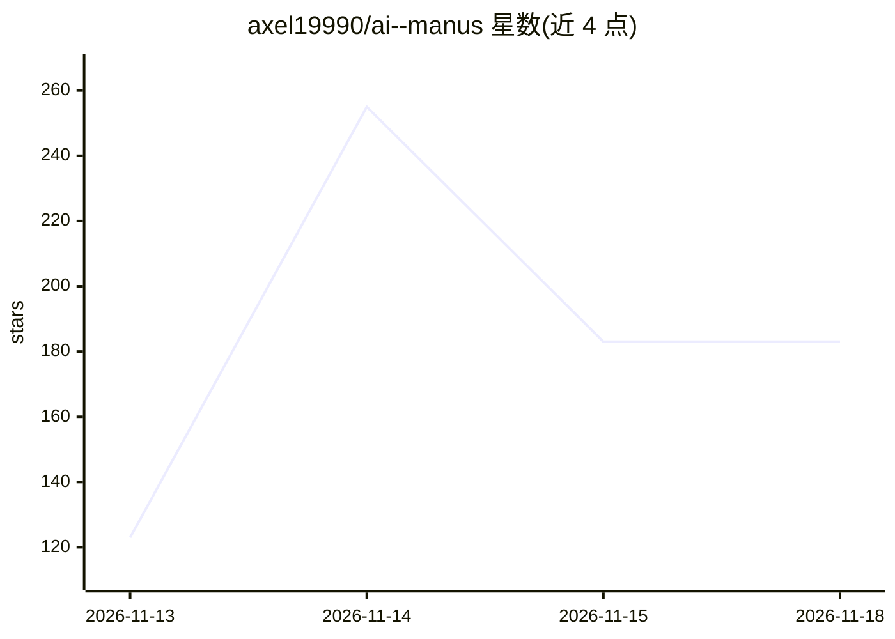

# axel19990/ai--manus

⭐ 183 · Apache-2.0 · 推送 2026-11-15 · [GitHub](https://github.com/axel19990/ai--manus) · 个人维护

**面向个人用户的自主 AI Agent：代跑代码与控制浏览器**

README 描述 Manus 为自主 AI agent，代表用户执行代码与浏览器操作：编写并运行脚本、打开网页、填写表单、跨脚本与浏览器完成多步骤任务，可在后台作为个人助理运行，面向学习、家庭项目与轻量办公场景，定位为非企业级的小规模助手。描述功能与使用步骤、兼容性表（4GB 内存起步、推荐 8GB），但 README 未给出具体安装命令、技术架构或模型接入方式，仅提供下载链接与促销码。

## 筛选速览

| 维度 | 判定 | 备注 |
|---|---|---|
| AI 角色 | `ai-native` | 本体是模型或模型工具 |
| 许可风险 | `permissive` | Apache-2.0 |
| 部署形态 | `None` |  |
| 模型依赖 | — | README 未给出锁定关系 |
| 硬件要求 | — | 无带数字的原话,不猜 |
| 安装摩擦 | `low` | 无编译、无系统依赖或容器化 |
| 成熟度 | — | 结构信号不足 |

## 能力要点

- 自主执行代码与浏览器控制（导航、填表、信息收集）
- 跨脚本与浏览器的多步骤任务流
- 后台个人助理模式，跨会话保持一致的任务逻辑

## 适用场景

- 让学生整理研究笔记、跑快速计算
- 代替我重复访问网页、填写表单、汇总多页信息
- 日常小任务的后台委托，减少手动操作

## 场景标签

`AI 助手` `浏览器自动化` · 领域:效率与自动化

## 证据(README 行号)

> L10: - **Autonomous Code Execution:** Manus AI agent runs code on its own to complete tasks, so you can focus on decisio
> L18: Manus is an autonomous AI agent designed to run code and control a browser on your behalf. Instead of acting like a

## 星数曲线

2026-11-13 123 → 2026-11-18 183（+60）

---
*卡片 v1 · prompt 1.4 · 生成 2026-11-17 · 置信度 mid · 依据 README sha `67c3d4d92b69` · [字段定义](../../DATASET.md)*
