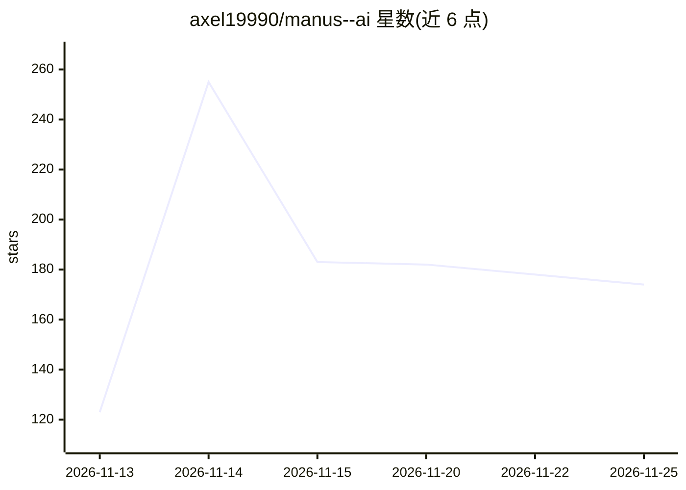

# axel19990/manus--ai

⭐ 174 · Apache-2.0 · 推送 2026-11-15 · [GitHub](https://github.com/axel19990/manus--ai) · 个人维护

**面向日常任务的自主 AI Agent：代用户执行代码与控制浏览器**

自称 Manus 的自主 AI Agent：用户描述需求后由 Agent 规划步骤，可编写并执行脚本、打开网页、与页面元素交互并完成多步骤任务，定位为家庭、学习与轻量办公的个人助手，强调无需编程背景。README 声明其记忆跨会话保持一致，脚本与浏览器操作可衔接。文档给出操作系统/CPU/内存等兼容性表格与上手六步流程，但未提供具体安装命令、技术架构、模型来源或代码仓库入口；页面顶部为下载链接与促销码。主题标签提及 openai、anthropic、gemini 等，README 正文未展开。

## 筛选速览

| 维度 | 判定 | 备注 |
|---|---|---|
| AI 角色 | `ai-native` | 本体是模型或模型工具 |
| 许可风险 | `permissive` | Apache-2.0 |
| 部署形态 | `None` |  |
| 模型依赖 | — | README 未给出锁定关系 |
| 硬件要求 | — | 无带数字的原话,不猜 |
| 安装摩擦 | `low` | 无编译、无系统依赖或容器化 |
| 成熟度 | — | 结构信号不足 |

## 能力要点

- 自主执行代码与浏览器控制（导航网页、填表、抓取信息）
- 脚本与浏览器操作在同一流程内衔接，支持多步骤任务
- 跨会话保持任务模式记忆，可后台待命响应
- 声明面向家庭/学习/轻量办公的小规模场景，非企业平台

## 适用场景

- 让 Agent 代为完成查网页、填表、整理研究资料等重复性事务
- 学习中运行小脚本、组织笔记而无需自建编程环境
- 远程办公时从多个页面收集信息并准备摘要

## 场景标签

`AI 助手` `浏览器自动化` · 领域:效率与自动化

## 证据(README 行号)

> L10: - **Autonomous Code Execution:** Manus AI agent runs code on its own to complete tasks, so you can focus on decisio
> L18: Manus is an autonomous AI agent designed to run code and control a browser on your behalf. Instead of acting like a

## 星数曲线

2026-11-13 123 → 2026-11-25 174（+51）

---
*卡片 v1 · prompt 1.4 · 生成 2026-11-17 · 置信度 mid · 依据 README sha `67c3d4d92b69` · [字段定义](../../DATASET.md)*
